# SolarHive
## AI-Powered Community Solar Energy Intelligence
### *(Unsloth + Ollama + llama.cpp + LiteRT + Cactus Special Tech Tracks)*

> **The Gemma 4 Good Hackathon** — Google DeepMind x Kaggle
> **Track:** Global Resilience
> **Special Technology Tracks:** Unsloth, Ollama, llama.cpp, LiteRT, Cactus

[](https://kaggle.com/competitions/gemma-4-good-hackathon)
[](https://kaggle.com/models/google/gemma-4)
[](https://huggingface.co/spaces/Truthseeker87/solarhive)
[](https://ollama.com/library/gemma4)
[](https://github.com/ggml-org/llama.cpp)
[](https://unsloth.ai)
[](LICENSE)

---

## The Dream

> *Each household in any given community is a potential energy producer
> and consumer — making it a potential clean energy island.*
>
> *Community-based storage such as fuel cells (e.g., solid oxide fuel
> cells or salt-based fuel cells) will help capture excess energy in
> each community of households to compensate for low production
> efficiency of solar.*
>
> *Energy can be distributed across communities based on energy needs
> in a decentralized live or hybrid grid — as opposed to a dead grid.*

**SolarHive is an open source prototype of an advisory layer for
community microgrids and shared storage. Its long term goal is to help
neighborhoods pool midday solar surplus and plan around solar
irradiance and cloud cover forecasts.**

SolarHive uses Gemma 4 to answer questions about a modeled community of
12 homes in Ann Arbor, Michigan. It combines live weather, irradiance
and grid data from public APIs with a simulated shared battery. It is a
hackathon learning project. It does not control any real microgrid
equipment.

---

## Why This Matters to Me

I chose Ann Arbor, Michigan as SolarHive's prototype location because I live here — after years in New York and Boston. The project models suburban rooftop solar conditions and does not survey actual shading at local sites.

My motivation runs deeper than a hackathon:

**The dream of household energy production.** Every home in a community is a potential energy producer and consumer — a clean energy island. Community-based storage using batteries and fuel cells (solid oxide or salt-based) can capture surplus energy to compensate for solar's low production efficiency. This dream was sparked during my undergraduate years at the National University of Singapore, where electives in green energy, atmospheric chemistry, and evolutionary biology taught me the deep connection between photosynthesis, carbon sequestration, and Earth's climate systems.

**Live grids for critical infrastructure.** Decentralized energy generation can supplement existing grids for burstable demands — hospitals, AI-optimized data centers, telecommunications networks, traffic systems, and solar-powered seawater desalination plants like the one announced in Yeosu, South Korea.

**The unsolved side of the energy equation.** In 2024, I visited Schneider Electric's headquarters in Paris to learn from chief executives including former Group CFO Hilary Maxson. While strong private-sector players like Schneider have solved many problems in energy *distribution*, the other side of the equation — energy *production* and source diversity — remains a global challenge. That visit refocused my research on production.

**Singapore's example.** My home country continues to invest actively in energy production diversification, providing real-world case studies for household energy generation and community storage.

**A personal stake in the future.** My wife and I are expecting our firstborn — a girl we are naming Gemma. The coincidence with Google's model name is not lost on me. I need to play my part, however small, to help pave the way for future generations rather than leave our problems to them.

---

## The Problem: Why Solar Production Efficiency Is Low

Solar energy and photovoltaic cells have low production efficiency due
to a cascade of factors that compound at every stage from sunlight to
usable electricity.

*Source note: the percentages and ranges in this section have no cited
source. They are unsourced estimates. This project did not measure
them.*

### Environmental & Locational Factors

**Location, climate, and seasonality:** Communities and households in
different locations experience varying amounts of sunlight. Spring,
summer, fall, and winter each produce dramatically different solar
irradiance profiles. Michigan receives roughly 1,400 kWh/m²/year
versus 2,000+ kWh/m²/year in Colorado — a 30% gap from geography alone.

**Changes in cloud cover:** Atmospheric conditions including clouds,
aerosols, and pollutants can reduce electricity output by up to 60%.
Cloud intermittency causes sudden production drops that are particularly
wasteful without local storage.

**Dust, dirt, and debris:** Soiling from dust, pollen, and bird
droppings reduces light absorption and can cut panel efficiency by
5–30%. In extreme cases, debris creates hot spots that permanently
damage cells.

### Physics & Material Losses

**Electron losses across silicon layers:** As electrons travel across
the anodes, cathodes, and silicon layers of photovoltaic cells, energy
is lost to resistive and recombination effects. These charge carrier
collection losses and conduction losses are inherent to the
semiconductor physics of solar cells.

**Silicon type matters:** The use of amorphous or polycrystalline
silicon (as opposed to monocrystalline) significantly reduces
efficiency. Amorphous silicon panels achieve only 6–10% efficiency
versus 20–25% for monocrystalline. Polycrystalline falls in between
at 15–17%. The crystal structure directly affects how freely electrons
can move.

**Temperature and thermal losses:** Panel efficiency drops 0.4–0.5%
per degree Celsius above 25°C. A hot summer day at 40°C can reduce
output by 6–7.5% from thermal effects alone.

**Optical reflection losses:** Light bouncing off the panel surface
rather than being absorbed. Anti-reflective coatings help but cannot
eliminate this entirely.

**Spectral mismatch:** Solar cells can only convert certain wavelengths
of sunlight. Energy outside the cell's absorption band is wasted as
heat, bounded by the Shockley–Queisser theoretical limit of ~33% for
single-junction cells.

### System-Level Losses

**Inverter conversion losses:** Converting DC to AC power costs 3–5%
efficiency through the inverter.

**Panel degradation over time:** Monocrystalline panels lose 0.3–0.5%
efficiency per year, accumulating ~8% loss over 20 years.

**Shading and partial obstruction:** Trees, buildings, or even one
panel's shadow on another can disproportionately reduce output for an
entire string of panels.

**Wiring and connection losses:** DC cable losses occur whenever
current flows. Bypass diode losses, mismatch between panels, and
junction box resistance all compound.

### The Compounding Problem

These losses compound. A community in Ann Arbor with polycrystalline
panels on a partly cloudy 85°F day with moderate dust might see the
following. The factors are illustrative assumptions, not measurements.

```
70% location factor
× 60% cloud factor
× 95% thermal efficiency
× 95% soiling factor
× 95% inverter efficiency
─────────────────────────────
≈ 36% of rated capacity reaching the household as usable electricity
```

This is why community-level intelligence and shared storage are not
luxuries — they are necessities for making solar viable.

---

## The Solution

SolarHive addresses the compounding efficiency problem at the community
level through three mechanisms:

**Collective intelligence:** Each household is both a producer and
consumer. The goal is an advisory layer that sees the whole community's
energy state and plans for the group rather than for each home alone.
The current prototype answers questions about one modeled community. It
does not read real household meters.

**Community storage:** The prototype simulates a shared battery. It does not measure export reduction, energy savings or storage efficiency.

**Decentralized live grid:** Energy flows within the community based on
real-time need — a live, breathing grid rather than the dead,
one-directional grid of traditional utility infrastructure. SolarHive
aims to advise on these flows. The prototype does not control them.

> *SolarHive does not change the physics of solar panels.
> It aims to change how communities USE what those panels produce.*

---

## How Gemma 4 Powers SolarHive

SolarHive leverages three core Gemma 4 capabilities, directly aligned
with what the hackathon demands: **multimodal power**, **native
function calling**, and **domain-adapted fine-tuning**.

---

### Feature 1 — Multimodal VQA (Three Modes)

#### VQA Mode 1 — Sky Condition Analysis *(Primary Demo Moment)*

A community member photographs the sky. The user asks:
*"How will this affect our solar production?"*

Gemma 4 analyzes cloud formations, estimates coverage percentage,
combines this with live weather API data via function calling, checks
community battery state, and responds with a grounded, actionable
forecast — multimodal vision and native tool calling working together
in a single agentic turn.

> *"The image shows heavy, uniform overcast conditions with thick gray
> cloud cover obscuring the sun completely. This type of overcast sky
> typically reduces solar production to 10-25% of clear-sky capacity.
> At this moment, expect roughly 10-25 kW community output from your
> 60 kW array. This is a good time to conserve battery for evening
> peak hours and defer non-essential loads."*

This is the April 15, 2026 output, quoted verbatim. The community array
is 72 kW. The model stated 60 kW in error (see Live Demo Output below).
The model called no tools for this answer.

#### VQA Mode 2 — Panel Health Inspection

A homeowner photographs their rooftop panels. Gemma 4 visually
identifies dirt and debris buildup, shading from trees, physical
damage, or suboptimal tilt. It cross-references visual findings with
that home's production data to quantify the efficiency impact.

> *"I can see significant dust on your panels. Your production has been
> 15% below the neighborhood average, which is consistent with what
> I'm seeing."*

Illustrative example, not a model output.

#### VQA Mode 3 — Neighborhood Aerial Assessment

Upload a satellite or aerial image of the neighborhood. Gemma 4
identifies which roofs have panels, estimates orientation and potential
capacity, and spots shading issues. Useful for community planning.

> *"Three homes on Oak Street have south-facing roofs with no panels —
> they'd add an estimated 12kW to the community grid."*

Illustrative example, not a model output. In the May 2026 inference run,
the VQA tests used synthetic placeholder images. The aerial test reply
said it could not analyze the placeholder image. VQA quality was not
scored.

---

### Feature 2 — Native Function Calling (Agentic)

SolarHive uses Gemma 4's native tool call protocol. The model selects
tools through Gemma 4's dedicated tool call tokens.

Tools are passed via `apply_chat_template(tools=[...])` and the model
autonomously decides which tools to invoke using Gemma 4's dedicated
control tokens (`<|tool_call>` and `<|tool_response>`).

**Five tools Gemma 4 can invoke autonomously — all three keyed APIs (OWM, EIA, NREL) actively wired:**

| Tool | API | Returns |
|------|-----|---------|
| `get_weather(location)` | OpenWeatherMap (`OWM_API_KEY`) | Temperature, clouds %, wind, humidity, sunrise/sunset |
| `get_solar_production(clouds_pct, temp_f)` | Open-Meteo GHI (keyless) | Production kW, efficiency %, GHI W/m², temp derating |
| `get_battery_state()` | Community BMS (simulator) | State of charge, capacity, charging status |
| `get_grid_status()` | EIA Open Data (`EIA_API_KEY`) | Pricing period, rate/kWh, renewable %, CO2 intensity |
| `get_nrel_pvwatts_baseline()` | NREL PVWatts v8 (`NREL_API_KEY`) | Annual + current-month typical kWh + avg kW for the 72 kW array |

**The four-stage agentic loop:**

```
Stage 1 — Tool Definition
  Five tools passed to Gemma 4 via apply_chat_template(tools=[...])
  with typed Python signatures and Google-style docstrings.
  Gemma 4's chat template automatically generates the tool schema.
          ↓
Stage 2 — Model Decides
  Gemma 4 analyzes the question, reasons about which data it needs,
  and emits structured tool_call tokens requesting specific tools.
          ↓
Stage 3 — Developer Executes
  Code intercepts each tool_call via regex parsing (call:fn_name{args}),
  executes the real API request (OpenWeatherMap, Open-Meteo, EIA, NREL
  PVWatts), and feeds results back as a TWO-message sequence:
      {"role": "assistant", "tool_calls": [{"function": {...}}, ...]}
      {"role": "tool", "name": "<fn>", "content": "<JSON string>"}
  Loops up to 3 rounds. This 2-message format is byte-identical to what
  solarhive_datagen.py emits and solarhive_finetune.py trains on, so the
  inference path matches the training distribution exactly.
          ↓
Stage 4 — Model Responds
  Gemma 4 reads the tool results and synthesizes a final,
  grounded recommendation based on actual live data.
```

> **Training/inference alignment:** the 2-message `{role:assistant, tool_calls:...}` + `{role:tool, name, content}` format is shared across `solarhive_datagen.py` (training-data generation), `solarhive_finetune.py` (SFT preprocessing + schema validation), `solarhive_inference.py` Cell 4 `generate_with_tools()` (transformers agentic loop), `solarhive_inference.py` §13g (Ollama agentic loop), and `solarhive_inference_e4b_gguf_ollama.py` `_build_gemma4_prompt()` (local GGUF deployment). This differs from Google's vanilla function-calling docs (which use a single message with `tool_calls` + `tool_responses` keys) — we use the 2-message form because that's what the model was fine-tuned on; switching would mismatch the training distribution.

**Why this matters — selective tool reasoning:**

```
"What time does peak pricing start?"
→ Model calls: get_grid_status() only

"Is today's production above typical for January?"
→ Model calls: get_solar_production() + get_nrel_pvwatts_baseline()

"Should I run my pool heater now?"
→ Model calls: get_weather() + get_solar_production()
               + get_battery_state() + get_grid_status()
```

The examples above show the intended routing. In the May 2026 inference
run (notebook 3), the 26B A4B LoRA variant selected the expected tools
on 4 of 5 routing prompts. It did not chain calls for the three city
comparison prompt.

**Inference-time When2Call validation (`solarhive_inference.py` §11b — `WHEN2CALL_PROBES`).**
Three When2Call style probes check three of the four categories in
[Ross, H., Mahabaleshwarkar, A. S., & Suhara, Y. (2025).
*When2Call: When (not) to Call Tools.* arXiv:2504.18851](https://arxiv.org/abs/2504.18851).
Ross et al. (2025) report that public tool calling datasets rarely
include follow up or unable to answer examples. They link this gap to
higher tool hallucination rates. This project did not measure an
untrained baseline.

| Category | Probe                                              | Expected behavior                                                |
|---------:|----------------------------------------------------|------------------------------------------------------------------|
| **(b)**  | "What's the current grid rate?"                    | Correct tool call (`get_grid_status`) — well-specified, in-scope |
| **(c)**  | "How much will a 10 kW array produce today?"       | Follow-up question (asks for location) — does NOT auto-fill Ann Arbor |
| **(d)**  | "What's the current air quality index in Ann Arbor?" | Polite refusal + redirect (e.g., airnow.gov) — does NOT hallucinate an `get_aqi` tool |

The training data includes the `_UNABLE_TO_ANSWER` and
`_FOLLOW_UP_QUESTIONS` categories from
[`solarhive_datagen.py`](https://huggingface.co/datasets/Truthseeker87/solarhive-community-solar-multimodal).
The probes are not held out. Close paraphrases of all three probes
appear in the training data (`solarhive_datagen.py` lines 2717, 5079
and 5107). The probes use a lenient keyword matcher. On these probes,
the A4B variants scored 3 of 3 and the E4B variants scored 2 of 3, each
measured in a single run. See the Multi-Variant Deployment Validation
section below for the full breakdown.

**Example grounded response:**

> *"Battery is at 72%, partly cloudy with 55% production. You have
> headroom — run it now before peak pricing starts at 4pm."*

**VQA + Function Calling in one agentic turn:**

When the user uploads a sky photo alongside their question, Gemma 4
processes the image via its vision encoder, reasons about both the
visual input and the question, then decides which tools to call. This
is multimodal and native function calling working together in a single
agentic turn — the exact pattern the hackathon emphasizes.

```python
# One call: image analysis + live API tool calling + grounded response
result = solarhive_agent(
    question="How will this sky affect our production? Should I charge my EV now?",
    image=sky_photo   # Gemma 4 processes image AND calls tools in one turn
)
# → tool_calls: [get_weather, get_solar_production, get_battery_state, get_grid_status, get_nrel_pvwatts_baseline]
# → response: grounded answer citing both visual observation and live API data
```

---

### Feature 3 — Dual Fine-Tuned Domain Expert *(Unsloth + Ollama + llama.cpp Special Tech Tracks)*

**Why these models?** Gemma 4 offers four model sizes. We compared all
four using Google's published benchmarks. This project fine tuned and
ran only E4B and 26B A4B. One serves cloud inference and one serves
edge deployment:

| Model | Params (Total / Active) | Architecture | Vision Encoder | Context | Modalities | Selection |
|-------|------------------------|--------------|---------------|---------|------------|-----------|
| E2B | 5.1B / 2.3B effective | Dense + PLE | ~150M | 128K | Text, Image, Audio | **Considered for Ollama serving. Not fine tuned or shipped.** |
| E4B | 8B / 4.5B effective | Dense + PLE | ~150M | 128K | Text, Image, Audio | **Fine tuned for edge.** This project did not measure T4 memory use. |
| 26B A4B | 25.2B / 3.8B active | MoE (8/128) | ~550M | 256K | Text, Image | **Fine-tuned for cloud.** Lowest training loss of the two fine tunes (0.6956). 256K context. |
| 31B | 30.7B / 30.7B | Dense | ~550M | 256K | Text, Image | **Not selected.** About 3 points higher than 26B A4B on MMMU Pro and MMLU Pro. This project did not measure its speed. |

*Source: [Gemma 4 Model Card](https://gemma.ai/models/gemma-4/model-card/) (the older ai.google.dev link now redirects there). All four models support native function calling and agentic workflows.*

**Benchmark context:**

The table below contains Google's published base model benchmarks. These results provide model selection context. They do not measure SolarHive quality, speed or cost.

| Benchmark | SolarHive Use Case | E2B | E4B | **26B A4B** | 31B |
|-----------|-------------------|-----|-----|-------------|-----|
| MMMU Pro (vision) | Sky/panel VQA analysis | 44.2% | 52.6% | **73.8%** | 76.9% |
| MATH-Vision | Visual reasoning on solar data | 52.4% | 59.5% | **82.4%** | 85.6% |
| OmniDocBench (↓better) | Document understanding | 0.290 | 0.181 | **0.149** | 0.131 |
| MMLU Pro | Domain expertise (energy advisory) | 60.0% | 69.4% | **82.6%** | 85.2% |
| GPQA Diamond | Scientific reasoning | 43.4% | 58.6% | **82.3%** | 84.3% |
| MRCR v2 128K | Long context retrieval | 19.1% | 25.4% | **44.1%** | 66.4% |
| CoVoST (audio) | Future voice interaction | 33.47 | 35.54 | — | — |

These are Google's published results for the base models. They do not
measure SolarHive. On MMMU Pro and MMLU Pro, 31B scores about 3 points
higher than 26B A4B. On MRCR v2 128K, 31B scores 22 points higher. This
project did not measure 31B speed or cost. E4B and E2B accept audio
input. The 26B A4B and 31B models do not. This makes E4B and E2B the
candidates for future voice interaction at the edge.

**Key architectural decisions:**

- **26B A4B for cloud inference:** Google reports higher base model vision benchmark scores for 26B A4B than for E4B. SolarHive did not score VQA, so this project does not establish superior sky or panel analysis. The model activates 3.8B of 25.2B parameters per token and supports a 256K context window. The parameter and benchmark values appear in the [official Gemma 4 model card](https://gemma.ai/models/gemma-4/model-card/).
  Training loss (average of the last 20 steps) was
  0.6956 for 26B A4B and 0.9218 for E4B. No validation loss was
  measured, so these values do not compare model quality. In the May
  2026 run, the NF4 variant used 49.2 GB of GPU memory on one GPU
  (notebook 3).

- **E4B for fine-tuning (edge path):** Compact dense model with
  Per-Layer Embeddings (PLE) for memory efficiency. Supports
  image + audio + text (Any-to-Any) — enabling future voice interaction
  for community members querying energy status from mobile devices
  (CoVoST 35.54 — unavailable on 26B A4B/31B). All Gemma 4 models
  share the same native function-calling protocol, so E4B retains full
  tool-use capability at the edge. Trains in just 420s on RTX PRO 6000.
  LoRA adapters merge to safetensors for Ollama.

- **E2B was considered and not shipped.** E2B was considered as an
  Ollama serving target. Every measured Ollama result in this README
  uses the fine tuned E4B Q4_K_M GGUF. No E2B fine tune is published.

- **31B not selected:** The dense 30.7B model scores about 3 points
  higher than 26B A4B on vision (MMMU Pro 76.9% vs 73.8%) and reasoning
  (MMLU Pro 85.2% vs 82.6%) in Google's published results. It needs
  more GPU memory because all 30.7B parameters are active. This project
  did not measure 31B speed or quality.

Two models fine-tuned via Unsloth LoRA on the canonical SolarHive
training corpus, targeting both cloud and edge deployment:

| Model | Role | Training | Export |
|-------|------|----------|--------|
| Gemma 4 26B A4B (MoE) | Cloud inference + VQA demo | LoRA r=16, BF16, 7,198s | LoRA adapters |
| Gemma 4 E4B (8B) | Edge deployment via Ollama | LoRA r=16, BF16, 420s | LoRA → Ollama |

**Training data:** [`solarhive-community-solar-multimodal`](https://huggingface.co/datasets/Truthseeker87/solarhive-community-solar-multimodal) — **1,727 rows** (1,713 text + 14 image-grounded), ~347K tokens. Composition:

- **413 hand-crafted Q&A** spanning 15+ US cities and 9 energy domains
  (sky conditions, battery management, panel health, consumption
  optimization, community/grid strategy, emergency resilience, seasonal
  planning, multi-step reasoning, alternative storage)
- **~1,117 API-grounded Q&A** generated from live Open-Meteo (GHI/DNI/DHI,
  low/mid/high cloud cover), NREL PVWatts v8, OpenWeatherMap, and EIA
  Open Data v2 — joined on `(location, hourly timestamp)` so each
  multi-source example carries co-occurring grounding for Ann Arbor, MI
  and San Mateo, CA
- **183 tool-calling examples** following the [When2Call](https://arxiv.org/abs/2504.18851)
  taxonomy — 106 *should-call*, 53 *should-not-call*, 10 *unable-to-answer*,
  6 *follow-up clarification*, 8 failure-recovery — so the model learns
  when to call tools, when to refuse politely, when to admit a tool
  cannot answer, and when to ask a clarifying question
- **14 image-grounded Q&A turns** from 7 manually-labeled Ann Arbor sky
  photographs (cloud type + percentage cloud cover, expected production
  traced via the same temperature-derated GHI formula used elsewhere)

Every numeric claim in an algorithmic answer traces to a real API
response — no LLM-generated numbers.

**Shared hyperparameters:** LoRA rank=16, alpha=16, dropout=0,
target=all-linear, lr=2e-4, optimizer=adamw_8bit, warmup=5 steps,
max_seq_len=2048, precision=BF16, seed=3407. Batch size auto-tuned
by free GPU VRAM at runtime.

**Training results (Google Colab G4 VM, RTX PRO 6000, BF16):**

| Model | Converged Loss | Trainable Params | Earlier check, April 2026 fine tune notebook (5 Q&A ungraded + 3 tool) | Final run, May 2026 inference notebook (5 Q&A ungraded + 5 tool, plus 3 When2Call probes) | Time |
|-------|---------------|-----------------|-----------------------|-------------------|------|
| Gemma 4 26B A4B | **0.6956** | 505.4M / 26.3B (1.92%) | **8/8** (5/5 Q&A recorded, 3/3 tool) | **9/10** (5/5 Q&A recorded, 4/5 tool) + 3/3 W2C | 7,198s |
| Gemma 4 E4B | **0.9218** | 41.2M / 8.0B (0.51%) | **8/8** (5/5 Q&A recorded, 3/3 tool) | **10/10** (5/5 Q&A recorded, 5/5 tool) + 2/3 W2C | 420s |

**How to read these scores.** The Q&A half of each 8/8, 9/10 and 10/10
score is not graded. The benchmark script records 5 of 5 Q&A for every
variant once it generates five answers (`solarhive_inference.py` lines
1436, 1537, 1599, 1732, 1838 and 1897). Only the tool routing and
When2Call columns are scored by code. The 8/8 score comes from the
earlier check at the end of the April 2026 fine tune notebook (notebook
2). The 9/10 and 10/10 scores come from the final May 2026 inference run
(notebook 3). The two checks use different tool prompts. The When2Call
probes have close paraphrases in the training data, so they are not
held out. Each score comes from a single run.

**Fine-tuning is text-only on the multimodal-capable corpus** — image
rows in the dataset are skipped at the data-prep layer. VQA at
inference time uses the base Gemma 4 model's pretrained vision encoder
(~150M params for E4B, ~550M for 26B A4B per the [official model
card](https://ai.google.dev/gemma/docs/core/model_card_4)), which is
not modified by our LoRA. This matches the Vertex AI Gemma 4 SFT
recipe documented in the [Hugging Face blog](https://huggingface.co/blog/gemma4),
which explicitly freezes both vision and audio towers during
text-focused fine-tuning.

*Isolated checks run without tool schemas. Production checks run in the
full agentic loop with tool definitions passed via
`apply_chat_template(tools=[...])`. The May 2026 numbers come from
project prompts, not a public benchmark. The prompts are not held out.
Each variant ran once at the Kaggle-recommended sampling defaults
(`temperature=1.0`, `top_p=0.95`, `top_k=64`). In that run, the 26B A4B
selected the expected tools on 4 of 5 routing prompts.*

**Precision pipeline — BF16 is Gemma 4's native release format.** Google
publishes the open-source [Gemma 4 base](https://huggingface.co/google/gemma-4-26b-a4b-it)
in BF16; there is no FP32 release to begin with. Our LoRA fine-tuning
runs at BF16 over that BF16 base, and Unsloth's `save_pretrained_merged(method="merged_16bit")`
folds the LoRA delta into the base weights at the same BF16 precision.
The NF4 step is therefore the **only** quantization in the entire
SolarHive 26B A4B pipeline:

```
Google's open-source Gemma 4 26B A4B base (BF16, native release precision)
  ↓ LoRA fine-tuning at BF16
solarhive-26b-a4b-lora (BF16 adapter delta, ~2 GB)
  ↓ merge_16bit
solarhive-26b-a4b-merged (BF16 full weights, 51.61 GB on disk, same precision as base)
  ↓ BitsAndBytesConfig(load_in_4bit=True, nf4)  ← only quantization step
solarhive-26b-a4b-nf4 (partial NF4 + BF16 hybrid, 48.34 GB on disk)
```

Sizes are decimal GB from the Hugging Face file listings. The merged
model is two shards of 49.91 GB and 1.70 GB. The NF4 file is close in
size to the merged file. In the May 2026 run, the NF4 variant used 49.2
GB of GPU memory (notebook 3).

**Quantization result.** The 26B A4B was
re-merged from the published LoRA + base model and NF4-quantized via
`BitsAndBytesConfig` for HF Spaces deployment. In the May 2026 inference
run, the NF4 variant
([`solarhive-26b-a4b-nf4`](https://huggingface.co/Truthseeker87/solarhive-26b-a4b-nf4))
scored 4 of 5 on tool routing, the same as the BF16 merged variant
(notebook 3). The earlier 8 question NF4 check is reported on the NF4
model card. Its notebook is not in this repository. The six model repos
(`solarhive-26b-a4b-{lora,merged,nf4}`,
`solarhive-e4b-{lora,ollama,gguf}`) carry the v2 weights. Some model
card text conflicts with the archived runs (see Known Limitations). The `-e4b-lora` repo was added separately to
expose the E4B LoRA delta as a standalone artifact (it had previously
only existed as a Drive backup; the merge → safetensors push from the
fine-tuning notebook was the only HF artifact for the E4B family until
that step). It bootstraps the `solarhive_merge_e4b.ipynb` recipe so
that notebook is now runnable on a fresh Colab session.

### Feature 4 — Edge GGUF Deployment *(Ollama + llama.cpp Special Tech Tracks)*

The fine-tuned E4B was quantized to a standard Q4_K_M GGUF (Q6_K on the PLE tensor, Q4_K elsewhere) for Ollama / llama.cpp edge deployment, and inferenced on a 16 GB Intel i5-1135G7 laptop CPU via Ollama 0.21.0.

| | SolarHive E4B Q4_K_M GGUF |
|---|---|
| GGUF size | **5.34 GB** (Q6_K-PLE) |
| Quantization hardware | High-RAM cloud notebook (llama.cpp default Q4_K_M); 16 GB-laptop recipe below |
| Inference hardware | 16 GB Intel i5 laptop CPU |
| Domain Q&A (5 prompts) | 5/5 recorded (not graded) |
| Tool calling (5 prompts) | **5/5** |
| **Total, project check (not held out)** | **10/10** + 2/3 W2C, one local run. The results file is not committed. |
| HF artifact | [`solarhive-e4b-gguf`](https://huggingface.co/Truthseeker87/solarhive-e4b-gguf) → `solarhive-e4b-q4_k_m.gguf` (and `…-standard.gguf`, same quant) |

**Quantizing on a 16 GB laptop:** the standard Q4_K_M conversion needs a ~10.7 GB float32 buffer for the Q6_K PLE tensor and OOMs on 16 GB hardware. Adding `--tensor-type per_layer_token_embd.weight=q4_0` bypasses the buffer and yields a smaller (~4.6 GB) GGUF. This variant was tried in development. No quality results for it are committed. It is a reproducibility recipe, not a published artifact.

It pairs with the 992 MB [`mmproj-solarhive-e4b-BF16.gguf`](https://huggingface.co/Truthseeker87/solarhive-e4b-gguf) (vision SigLIP + audio Conformer, 1411 tensors) for full multimodal via `llama-server --mmproj`. The demo path uses Ollama's **`/api/generate` raw mode + a manual Gemma 4 prompt builder**. It bypasses Ollama 0.21.0's `gemma4.go` content-drop issue (which silently rejects fine-tuned Gemma 4's native tool-call format). With this path, the GGUF scored 5 of 5 on tool routing and 2 of 3 on the When2Call probes in one local run. The Q&A half was not graded. The results file from that run is not committed. See `solarhive_inference_e4b_gguf_ollama.py` for the implementation.

### Feature 5: Multi-Tier Hardware Deployment *(Five deployment targets)*

The table lists five deployment targets. Four use the SolarHive fine tune. The browser tier uses the upstream base E4B model. The Status column states what was tested.

| Tier | Hardware | Cost | Power | Runtime | Model variant | Track | Status |
|------|----------|------|-------|---------|---------------|-------|--------|
| **Phone (browser)** | Any Android / iOS / browser | $0 (existing phone) | phone battery | LiteRT / MediaPipe Tasks Web | Base E4B `.task` (upstream pre-converted) + SolarHive UX layer + on-device agentic loop | LiteRT | Browser app code in [`web-litert/`](web-litert/) loads the base E4B bundle. No browser test results are published. |
| **Phone (native)** | ARM64 Android / Apple Silicon | $0 (existing phone) | phone battery | [Cactus](https://github.com/cactus-compute/cactus) (mobile-NPU runtime) | Fine-tuned E4B → INT4 (`solarhive-e4b-cactus`) | Cactus | Convert pipeline run on Colab. Android APK released (v1.0). Tested with one prompt on one Snapdragon 865 Android device (Android 14, 12 GB RAM). See Feature 7 below. |
| **Community microgrid hub** | [Jetson Orin Nano Super Developer Kit](https://www.nvidia.com/en-us/autonomous-machines/embedded-systems/jetson-orin/nano-super-developer-kit/) | See current vendor pricing | **7 to 25 W** | [llama.cpp + CUDA](https://huggingface.co/blog/nvidia/gemma4) | Planned E4B Q4_K_M target | llama.cpp | Not tested. |
| **Admin / operator laptop** | Intel i5-1135G7 (any 16 GB CPU laptop) | existing hardware | CPU-only | Ollama (llama.cpp backend) | E4B Q4_K_M | Ollama + llama.cpp | 5 of 5 tool routing and 2 of 3 When2Call in one local run. Results file not committed. |
| **Cloud** | HF Space / Colab | Not applicable | Not applicable | transformers + Unsloth `FastVisionModel` | 26B A4B LoRA (BF16 or NF4) | Unsloth | HF Space is paused. Colab run in May 2026: 4 of 5 tool routing and 3 of 3 When2Call. |

One fine-tuning pipeline (Unsloth), one training dataset (1,727-row canonical corpus), one chat template and five Special Tech tracks (LiteRT, Cactus, llama.cpp, Ollama, Unsloth). The LiteRT tier uses the upstream base model, not the fine tune.

**Planned Jetson target:** SolarHive has not been tested on a Jetson. A future test must verify model loading, memory use, tool routing and response latency before this README can claim compatibility.

**Local inference:** Running Gemma 4 via Ollama, llama.cpp, or LiteRT keeps prompts on the device. Live data still comes from cloud APIs (OpenWeatherMap, Open-Meteo, EIA, NREL). Local inference is slower than the cloud GPU path.

### Feature 6 — On-Device Reasoning Pattern *(LiteRT browser tier)*

For the Phone / browser tier specifically, the recommended pattern is to couple the on-device E2B LiteRT model with a **deterministic workflow that pulls live data on the device or at a local endpoint, then injects the fetched values into the E2B prompt as grounded context.** E2B reasons over the context and emits the compact emoji response; it does not orchestrate API calls directly.

```
1. User taps "Run dishwasher?"
2. Device workflow fetches weather / GHI / battery / grid rates
   (native API calls, local sensor reads, or a server-side proxy)
3. Context is inlined into the E2B prompt:
     "Context: ☀️ clear, 820 W/m² GHI, 🔋 78%, 🟢 off-peak $0.08/kWh.
      User: Run dishwasher?"
4. E2B (LiteRT / MediaPipe Web / litert-lm) emits:
     "☀️🟢 Run now, peak solar plus off-peak grid."
5. UI renders leading emojis large + text underneath.
```

**Planned deterministic workflow:** This design would fetch data in application code and place the values in the model prompt. The project has not tested this E2B design on mobile, browser or Raspberry Pi hardware.

This E2B pattern is planned. No E2B fine tune, E2B LiteRT bundle or E2B notebook is published.

### Feature 7 — Cactus Integration *(Cactus Special Technology Track)*

> **Hackathon track:** Cactus Special Technology Track — *"For the best local-first mobile or wearable application that intelligently routes tasks between models."*
>
> **SolarHive's Cactus track entry rests on the "local-first mobile application" clause** — a Flutter Android app that loads SolarHive's fine-tuned Gemma 4 E4B INT4 multimodal artifact on-device and runs end-to-end inference on real ARM hardware (Snapdragon 865, 12 GB RAM, Android 14) with a multi-turn chat UI. The final submitted Run 13 validation intentionally measured one canonical single-prompt round-trip to show judges that the mobile path works end-to-end. Cross-model routing is not part of this submission's Cactus deliverable; the broader project does match query difficulty to deployment tier (cloud 26B A4B for tool-grounded queries, on-device E4B for typical chat-length advice), but that routing is documented as a project-architecture pattern across the deployment matrix above rather than wired into the Cactus app itself.

For the native mobile tier, the project used [Cactus](https://github.com/cactus-compute/cactus) to convert the fine tuned E4B weights ([`solarhive-e4b-ollama`](https://huggingface.co/Truthseeker87/solarhive-e4b-ollama)) to an INT4 artifact. The repository records one prompt on one Android device. It does not establish compatibility across every platform or accelerator listed by Cactus.

**Notebook:** [`solarhive_e4b_cactus.ipynb`](solarhive_e4b_cactus.ipynb) covers the full Cactus deployment pipeline end-to-end:

1. Install `cactus-compute` from GitHub with a name-collision verification gate
2. Compile `libcactus.so` via `cactus build --python` (the C++ engine, ARM hosts only)
3. Authenticate to HuggingFace and resolve the fine-tuned merged safetensors
4. Run `cactus convert ... --precision INT4` to produce the deployable mobile artifact
5. Inspect the artifact (per-file inventory + total size)
6. Run a 10-prompt smoke test via the Cactus Python SDK (Class A — five domain Q&A probes; Class B — five SolarHive emoji-format prompts)
7. Emit a three-outcome quality verdict

**Colab conversion results (`archive/final_run/4_solarhive_e4b_cactus_finalrun_May2026.ipynb`). The ARM build and Python SDK smoke test were skipped on the x86 host:**

- Install + auth + 16 GB safetensors download: **passed** (~1 min total)
- `cactus convert ... --precision INT4`: **passed** (exit 0, 274s ≈ 4.5 min; observed 4–7 min range across runs)
- Converted artifact: **6.94 GB INT4 multimodal** (audio Conformer + vision encoder retained FP16 alongside INT4 text)
- Tensor mix from Cactus's converter log: **343 INT4 + 2 INT8 + 1,732 FP16** (text weights INT4-quantized; audio + vision towers retained FP16)
- Cactus's reported quant fidelity (deterministic across runs): **CosSim 0.9946 mean / SNR 19.8 dB mean / MSE 5.18e-04 mean**

**Why two steps skip on x86 dev hosts.** The Cactus C++ engine targets ARM platforms by design — its CMake build hardcodes `-march=armv8.2-a+i8mm` and the SIMD kernels use ARM intrinsics with no x86 fallback. The official [Cactus Gemma 4 deployment blog](https://docs.cactuscompute.com/v1.14/blog/gemma4/) states verbatim: *"Cactus targets ARM across platforms: Apple Silicon Macs, iPhones, iPads, Vision Pro, and Android devices with ARM64 chipsets."* On x86 development hosts (Colab CPU/GPU runtimes, x86 servers) the build step + Python SDK smoke test gracefully skip; the convert step is pure-Python and runs anywhere, producing a deployable artifact for the companion Flutter Android app.

**Why the ARM code remains in the notebook.** The notebook includes the intended ARM build and SDK steps behind a platform check. Those steps were not run in the archived x86 notebook. They require a separate ARM test.

The companion **Flutter Android app** ([`mobile-cactus/`](mobile-cactus/)) loads the converted artifact on first launch and runs end-to-end inference on real ARM hardware. The 10 prompt quality gate in the notebook (Class A ≥4/5 + Class B ≥3/5) has not been run on a device. The on device validation used one prompt.

**On-device validation — release-flavor APK sideload test on Android device.** The companion app was validated end-to-end via a **release-flavor APK sideloaded** to **an Android mobile device** with the following hardware profile (kept generic for privacy; specific model/serial intentionally omitted):

- **SoC:** Qualcomm Snapdragon 865 (octa-core ARM64)
- **RAM:** 12 GB LPDDR5 (`MemTotal: 11.24 GiB` reported by `/proc/meminfo`)
- **OS:** Android 14
- **ABI:** `arm64-v8a` (the only Android ABI Cactus targets)

The validation cycle exercised both **USB-tethered adb** (cable-attached, stable build/install/launch loops) and **wireless adb (TLS, mDNS-paired)** (over local Wi-Fi, hands-off but susceptible to drops on screen sleep). The size-verified resumable downloader in [`mobile-cactus/lib/services/artifact_downloader.dart`](mobile-cactus/lib/services/artifact_downloader.dart) was specifically designed to survive wireless-adb drops — each file's local size is verified against HuggingFace's reported `size` from the tree API; mismatches are deleted and re-fetched on the next launch automatically. The full diagnostic instrumentation (artifact audit, `/proc/self/status` memory sampler, `CycleTimer` tap-to-render timer, and the multi-schema `GenerationStats` envelope parser) lives under [`mobile-cactus/lib/services/`](mobile-cactus/lib/services/) — `diagnostics.dart` + `cactus_engine.dart` + `llm_engine.dart` together write a structured trail to `${appDocs}/solarhive_diag.log` for every chat round-trip.

The sideloaded APK opens directly to a **multi-turn chat UI**. For the submitted validation, Run 13 intentionally used one canonical prompt (*"What is solar GHI?"*) so the evidence stayed focused on the full on-device inference stack end-to-end (FFI loader → file mmap → INT4 forward pass → JSON envelope parse → Dart-side LaTeX/markdown post-processor → render). The headline empirical baseline is the tap-to-render cycle at production config `contextSize=1024` + `maxNewTokens=512`. The table below is a single run with one prompt on one Snapdragon 865 device, using the release APK. The values come from the [`solarhive-e4b-cactus`](https://huggingface.co/Truthseeker87/solarhive-e4b-cactus) model card. No device log is committed to this repository.

| Metric (full term spelled out alongside the short form) | Value |
|---|---|
| **Tap-to-render cycle** (user tap on Send → assistant bubble rendered on screen) | **53.73 sec** |
| Share of cycle inside the `generate` await (FFI call boundary) | **99.88%** (`prep` 1 ms / `render` 62 ms — UI overhead structurally negligible) |
| Pure `cactus_complete` time (subset of `generate` after the one-time `cactus_init` prefix) | ~46.15 sec (~85.9% of cycle) |
| One-time `cactus_init` cold-load (file mmap + header parse + KV cache pre-allocation, on first chat round-trip) | ~7.36 sec |
| Peak HWM (High Water Mark — peak Resident Set Size during generation) | 3.55 GiB |
| sysFree throughout (system-wide `MemAvailable` from `/proc/meminfo`, lowest observed) | always ≥3.5 GiB |
| Crash signals (`SIGABRT` / `SIGKILL` / lmkd) | zero |

**Sample on device response:** The captured reply contains factual errors about GHI and panel tilt. The project did not score answer quality on the device. See the [response screenshot](archive/final_run/4_solarhive_e4b_cactus_finalrun_May2026_response.jpeg).

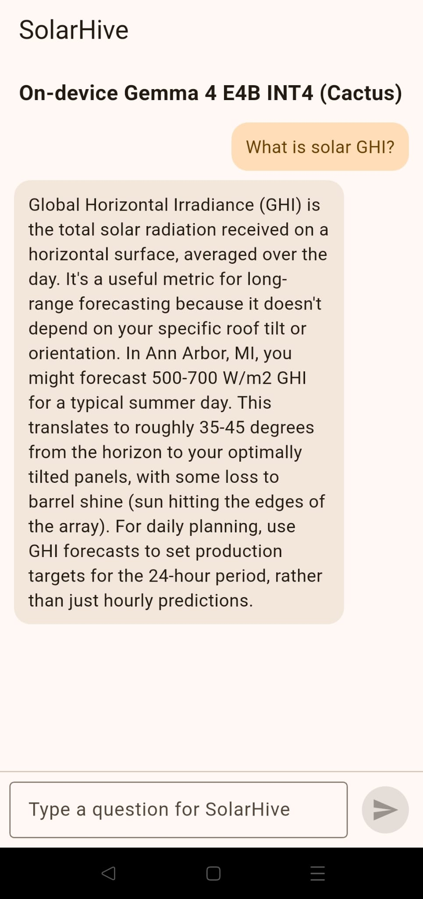

In the reported single prompt run, 99.88% of the measured cycle occurred inside the `generate` call. The value comes from the Hugging Face card, and no device log is committed here. One run does not establish the cause of latency or predict the effect of configuration changes. The sideloaded build is available from the [v1.0-mobile-cactus GitHub Release](https://github.com/youshen-lim/the-gemma4-good-hackathon-solarhive/releases/tag/v1.0-mobile-cactus).

**System prompt differences:** The device prompt retains the SolarHive identity and community facts but removes tool instructions because the device tier has no tools. It also requests assumptions instead of live data. Cloud benchmark results do not apply to this E4B INT4 device tier.

**Prompt repetition:** The device code repeats the system prompt. This adapts an idea from Leviathan, Kalman & Matias (2025), *Prompt Repetition Improves Non-Reasoning LLMs*, Google Research, [arXiv:2512.14982](https://arxiv.org/abs/2512.14982). The cited paper repeated the full input query, not the system prompt. This project did not measure the effect of its variation.

**Library versioning note.** The deployed `libcactus.so` binary on the companion app is built locally from [cactus-compute/cactus](https://github.com/cactus-compute/cactus) at a pinned commit via the Android NDK cross-compile toolchain. The pub.dev [`cactus 1.3.0`](https://pub.dev/packages/cactus) Flutter package is several months older than the converter that produced the artifact and has both a different `cactus_init` ABI and an incompatible weight-file header layout. Pinning the convert tool, the `libcactus.so` binary, and the Dart `cactus.dart` bindings to a single Cactus commit is the way to avoid the version drift; full build recipe + reproduction instructions live in the [`mobile-cactus/` README](mobile-cactus/) and the [HF model card](https://huggingface.co/Truthseeker87/solarhive-e4b-cactus).

**Citation.** Per the [Cactus repository](https://github.com/cactus-compute/cactus)'s recommended attribution:

```bibtex
@software{cactus,
  title  = {Cactus: AI Inference Engine for Phones & Wearables},
  author = {Ndubuaku, Henry and Cactus Team},
  url    = {https://github.com/cactus-compute/cactus},
  year   = {2025}
}
```

### Feature 8 — LiteRT Integration *(LiteRT Special Technology Track)*

> **Hackathon track:** LiteRT Special Technology Track — *"For the most compelling and effective use case built using Google AI Edge's LiteRT implementation of Gemma 4."*

For the **mobile / single-board / browser** edge tiers, SolarHive targets the LiteRT Special Technology Track via [Google AI Edge LiteRT-LM](https://ai.google.dev/edge/litert-lm) ([repository](https://github.com/google-ai-edge/LiteRT-LM)) — Google's first-party Gemma 4 edge inference framework, with SDK families for Android (Kotlin), iOS / macOS (C++; Swift APIs upcoming), Linux Python on edge hardware (Raspberry Pi 5, NVIDIA Jetson Orin Nano Super, laptops), Windows Python (upcoming), and Web (via the companion `.task` bundle on WebGPU). The April 2, 2026 Google Developers Blog [*"Bring state-of-the-art agentic skills to the edge with Gemma 4"*](https://developers.googleblog.com/bring-state-of-the-art-agentic-skills-to-the-edge-with-gemma-4/) endorses LiteRT-LM as the canonical mobile-edge runtime for Gemma 4 agentic workflows.

The LiteRT experiment uses the upstream base Gemma 4 E4B bundle from [`litert-community/gemma-4-E4B-it-litert-lm`](https://huggingface.co/litert-community/gemma-4-E4B-it-litert-lm), not the SolarHive fine tune. It ran only on Colab x86 Linux. Current [LiteRT Torch releases](https://github.com/google-ai-edge/litert-torch/releases/) list Gemma 4 export support, but this project has not attempted a new fine tune conversion with that support.

#### Runtime demo on LiteRT-LM Python

**Notebook:** [`solarhive_e4b_litert_v3.1.ipynb`](solarhive_e4b_litert_v3.1.ipynb) loads the upstream pre-converted base bundle via the LiteRT-LM Python SDK (`litert-lm-api-nightly`), runs an 8-prompt SolarHive benchmark + a 3-probe When2Call sub-bench + a Multi-Token Prediction probe + a multi-modal VQA probe, and emits a verdict tabulating the measurement against the verbatim mobile-edge benchmarks Google publishes in the [`litert-community/gemma-4-E4B-it-litert-lm`](https://huggingface.co/litert-community/gemma-4-E4B-it-litert-lm) model card.

**Base E4B model (not the SolarHive fine tune), run on Colab Pro CPU + High-RAM (Linux x86_64). Runtime demo archive [`archive/final_run/5_solarhive_e4b_litert_finalrun_May2026.ipynb`](archive/final_run/5_solarhive_e4b_litert_finalrun_May2026.ipynb):**

- **Q&A benchmark: 8/8** ✅ — every SolarHive prompt answered with grounded data; 13 tool calls executed across 8 prompts (six single-tool prompts plus two multi-tool comparisons)
- **Tool-call format: 9/9 native curly-wrapped, 0 parens drift** — base Gemma 4 E4B held the documented `<|tool_call>call:fn{...}<tool_call|>` format perfectly across every benchmark round; the parens-fallback regex shipped as belt-and-suspenders was empirically unused
- **Decode speed: 8.29 tokens per second (median) on a Colab x86_64 CPU.** Each benchmark prompt took 51 to 81 seconds end to end. The median time to first token was 41.38 seconds. Google's published figures for ARM devices (for example, 3.2 tokens per second on a Raspberry Pi 5) come from different hardware and are not directly comparable.
- **Engine cold-start: 15.32s** | **Warmup TTFT: 2.63s** | **Bundle download: 22.5s** for the 3.66 GB `.litertlm`
- **Multi Token Prediction probe:** The runtime skipped this probe because it requires a paired drafter artifact. The project did not test drafter pairing.
- **Multi-modal VQA probe: graceful skip on auth.** The sky-photo dataset was private at the time of the run. It is now public. The cell skipped and the rest of the run continued.
- **When2Call sub-bench: 1 of 3 (automated score).** Probe (b) ✅ correct tool routing; probe (c) auto-filled defaults instead of asking ❌; probe (d) replied *"I do not have a tool available to retrieve real-time air quality data..."*, but the scorer's keyword list missed *"do not"*. A manual review judged the (d) reply correct. The automated score is 1 of 3.

**Cross-platform plan.** The LiteRT notebook ran only on Colab x86_64 Linux. The other platforms in this table are untested. The table lists what should carry over based on the LiteRT-LM documentation.

| Mobile-edge target | What carries over | What changes |
|---|---|---|
| **Android phone** (Kotlin SDK) | `.litertlm` bundle, system prompt, 5 tool definitions, `_extract_tool_calls`/`_parse_tool_args` regex (Kotlin port), When2Call probe set | Engine + Conversation API switch from `litert_lm.Engine` (Python) → `LiteRTLMEngine` (Kotlin); native UI |
| **iPhone / iPad** (C++ SDK; Swift APIs coming) | same bundle, same prompt, same tool-call format | Engine + Conversation API in C++; Swift wrapper as it lands |
| **Browser on phone** (Chrome / Safari / Edge mobile) | same SolarHive prompt + tools; `.task` bundle (companion to `.litertlm`) | MediaPipe Tasks Web via `@mediapipe/tasks-genai`; covered by [`web-litert/app.js`](web-litert/) |
| **Raspberry Pi 5 microgrid hub** (ARM Linux Python) | identical SDK, identical bundle, identical code | nothing — same Python source runs |
| **NVIDIA Jetson Orin Nano Super** (ARM Linux Python) | identical SDK, identical bundle, identical code | nothing — same Python source runs |
| **Linux laptop** (x86_64 Python) | identical SDK, identical bundle, identical code | nothing — same Python source runs |

The agentic loop, tool call regex, system prompt and benchmark method are designed to move between SDKs. Moving from Colab Linux to Android Kotlin or iOS C++ should need SDK bindings, not a new design. This has not been tested.

#### Why the LiteRT tier uses base, not fine-tuned

The other Special Tech tiers (Cactus mobile, Ollama, llama.cpp, microgrid hub) all ship the SolarHive fine-tune ([`Truthseeker87/solarhive-e4b-ollama`](https://huggingface.co/Truthseeker87/solarhive-e4b-ollama)) end-to-end, but the LiteRT tier ships the upstream pre-converted base bundle. The asymmetry is driven by upstream conversion-tooling availability: as of the May 2026 submission, **we found no public path from fine-tuned Gemma 4 safetensors → `.litertlm`**. We checked these sources in May 2026:

- Google's [LiteRT conversion docs](https://ai.google.dev/edge/litert/conversion/overview) ship zero Gemma 4 examples and zero LoRA / fine-tune examples — ResNet18 is the sole PyTorch example.
- The `ai_edge_torch.generative.examples/` directory (the repository is now [`google-ai-edge/litert-torch`](https://github.com/google-ai-edge/litert-torch); see its [generative documentation](https://github.com/google-ai-edge/litert-torch/blob/main/litert_torch/generative/README.md)) contained `gemma`, `gemma3`, `paligemma`, and 19 other architectures (`amd_llama_135m`, `deepseek`, `embedding_gemma`, `falcon`, `hammer`, `llama`, `moonshine`, `openelm`, `phi`, `qwen`, `qwen_vl`, `smollm`, `smolvlm2`, `stable_diffusion`, `t5`, `tiny_llama`, etc.), but **no `gemma4` and no `gemma3n`** (verified via the GitHub Contents API). Gemma 3n is officially supported by the **MediaPipe LLM Inference runtime**, but its conversion code lives in internal Google tooling not exposed in the public examples tree, so the architectural-lineage hypothesis (load Gemma 4 weights via gemma3n builders) is moot.
- Google's [LLM Inference supported-models list](https://ai.google.dev/edge/mediapipe/solutions/genai/llm_inference) ships official example modules for Gemma 2 2B, Gemma 3 1B, and Gemma 3n E2B/E4B — but **not** Gemma 4 E-series.
- [Unsloth ships no LiteRT export path](https://unsloth.ai/docs/sitemap.md) (only GGUF / safetensors / Ollama / vLLM / llama-server / SGLang).
- [LiteRT-LM is runtime-only](https://github.com/google-ai-edge/LiteRT-LM) — it consumes pre-converted bundles produced upstream and ships no user-facing converter, per its repository description: *"Google's production-ready, high-performance, open-source inference framework for deploying Large Language Models on edge devices."*

We exercised the [Gemma 3 1B fine-tune codelab](https://colab.research.google.com/github/google-ai-edge/mediapipe-samples/blob/main/codelabs/litert_inference/Gemma3_1b_fine_tune.ipynb) pattern (`ai-edge-torch.generative` Python API + `mediapipe.tasks.python.genai.bundler.create_bundle()`) against fine-tuned Gemma 4 E4B weights and confirmed the upstream gap end-to-end. The architecture-builder probe graceful-skips when the upstream `gemma4` example module is absent, exactly as the GitHub Contents API verification predicts.

**Update, November 2026.** Current [LiteRT Torch releases](https://github.com/google-ai-edge/litert-torch/releases/) list Gemma 4 architecture export support. The May 2026 finding above may no longer hold. A new conversion attempt is needed before this README can say whether a fine tuned `.litertlm` bundle is possible. Until then, the LiteRT tier uses the upstream base model.

#### Next iteration — fine-tuned LiteRT-LM bundle (pending steps)

The planned follow-up is:

1. **Run the [LiteRT Torch](https://github.com/google-ai-edge/litert-torch) converter (formerly `ai_edge_torch.convert(...)`)** on [`Truthseeker87/solarhive-e4b-ollama`](https://huggingface.co/Truthseeker87/solarhive-e4b-ollama), the LoRA-merged BF16 safetensors (~16 GB), to produce a fine-tuned `.tflite`. (LoRA-only adapter weights live at [`Truthseeker87/solarhive-e4b-lora`](https://huggingface.co/Truthseeker87/solarhive-e4b-lora) and could alternatively be merged inline at conversion time.)
2. **Bundle the resulting `.tflite` + tokenizer** into a fine-tuned `.litertlm` via [`mediapipe.tasks.python.genai.bundler.create_bundle()`](https://ai.google.dev/edge/mediapipe/solutions/genai/llm_inference).
3. **Re-run the Q&A + When2Call + VQA benchmarks** against the fine-tuned bundle and compare against the upstream-base verdict above. The test is whether the fine tune changes the When2Call result. The cloud E4B fine tunes scored 2 of 3 on the same probes (see the [Multi-Variant Deployment Validation](#multi-variant-deployment-validation) section further down).
4. **Publish the fine-tuned bundle** to a new HF repo `Truthseeker87/solarhive-e4b-litert` for cross-tier variant consistency with the other Special Tech entries. The license is not yet decided.
5. **(Stretch) Pair a Multi-Token Prediction drafter** — once Google publishes a `.litertlm`-formatted MTP drafter for E4B in the [`litert-community/`](https://huggingface.co/litert-community) organization (analogous to [MLX's `gemma-4-assistant-mtp` collection](https://huggingface.co/collections/mlx-community/gemma-4-assistant-mtp)), pair it with the fine-tuned bundle for the up-to-3× decode speedup documented in Google's [May 5, 2026 MTP drafters announcement](https://blog.google/innovation-and-ai/technology/developers-tools/multi-token-prediction-gemma-4/).

#### Why LiteRT is the right phone-tier target regardless

LiteRT is purpose-built for on-device Gemma 4 inference where Cactus, Ollama, and llama.cpp do not reach:

- **Cross-platform from one bundle.** The same `.litertlm` runs on [Android, iOS, Linux, macOS, Windows, Raspberry Pi 5, and Web](https://huggingface.co/litert-community/gemma-4-E4B-it-litert-lm); the model card reports 3.2 tokens per second decode on a Raspberry Pi 5 16 GB CPU. SolarHive has not been tested on a Pi 5.
- **Browser-native, zero-install** — judges open a URL, the `.task` streams from Hugging Face, MediaPipe + WebGPU executes Gemma 4 E4B locally on the device. No app store, no APK, no native SDK install. The Web Chrome (M4 Max GPU) benchmark on the model card reports 44.4 tok/s decode.
- **WebGPU acceleration** — Chrome / Edge auto-route inference to the integrated GPU; mobile Chrome on Android also activates WebGPU on supported GPUs.
- **Privacy by construction** — all inference happens on the user's device; no API key in page source, no model weights leave the local process. Aligns directly with the SolarHive *"local-first, privacy-first"* posture that motivates the Special Tech Track strategy across Ollama, llama.cpp, Cactus, and LiteRT.
- **Open standards, no vendor lock-in** — MediaPipe Tasks API + [WebGPU](https://www.w3.org/TR/webgpu/) spec; no proprietary SDK to license. Works offline once the bundle is browser-cached.
- **Upstream bundles:** The [litert-community](https://huggingface.co/litert-community) organization publishes converted [E2B](https://huggingface.co/litert-community/gemma-4-E2B-it-litert-lm) and [E4B](https://huggingface.co/litert-community/gemma-4-E4B-it-litert-lm) bundles. SolarHive used the E4B bundle and did not perform that conversion.

#### Browser companion ([`web-litert/`](web-litert/))

The browser code in [`web-litert/`](web-litert/) loads an upstream base E4B bundle and implements local solar and battery tools. No browser test results are published. The solar tool currently shares the Fahrenheit derating bug described in Known Limitations, so this README does not claim numerical equivalence with another runtime.

**Citation.** Per the [LiteRT homepage](https://ai.google.dev/edge/litert), [LiteRT-LM repository](https://github.com/google-ai-edge/LiteRT-LM), and the April 2, 2026 Google Developers Blog:

```
LiteRT — Google AI Edge:           https://ai.google.dev/edge/litert
LiteRT-LM (runtime + landing):     https://ai.google.dev/edge/litert-lm
LiteRT-LM repository:              https://github.com/google-ai-edge/LiteRT-LM
LiteRT Torch (converter):          https://github.com/google-ai-edge/litert-torch
MediaPipe LLM Inference (docs):    https://ai.google.dev/edge/mediapipe/solutions/genai/llm_inference
MediaPipe LLM Inference (Web):     https://ai.google.dev/edge/mediapipe/solutions/genai/llm_inference/web_js
mediapipe-samples (codelabs):      https://github.com/google-ai-edge/mediapipe-samples
litert-community model bundles:    https://huggingface.co/litert-community
Pre-converted Gemma 4 E4B bundle:  https://huggingface.co/litert-community/gemma-4-E4B-it-litert-lm
Apr 2, 2026 Google Developers Blog "Bring state-of-the-art agentic skills to the edge with Gemma 4":
  https://developers.googleblog.com/bring-state-of-the-art-agentic-skills-to-the-edge-with-gemma-4/
```

---

## Architecture

```
Core pipeline (three of the five archived notebooks):

solarhive_datagen.py     Data generation: 4 live APIs → 1,727 training rows
        ↓                + 14 diagnostic charts
solarhive_finetune.py    Dual LoRA fine-tuning via Unsloth
        ↓                E4B (420s) + 26B A4B (7,198s)
solarhive_inference.py   Inference: fine-tuned 26B A4B + 5 tools
                         + 3 VQA modes + agentic loop + benchmarks

The other two archived notebooks cover Cactus conversion and the
LiteRT runtime demo.

Hardware: Google Colab G4 VM — NVIDIA RTX PRO 6000 Blackwell
          Server Edition (96 GB product spec; PyTorch reports 102 GB,
          Unsloth reports 94.97 GB usable), BF16 precision
Platform: Google Colab Pro
```

**Agentic loop (Cell 4):**
1. System prompt repeated twice. This adapts the full query repetition
   tested by [Leviathan et al., 2025, Google Research](https://arxiv.org/abs/2512.14982).
   This project did not measure its effect.
2. Tools defined as Python functions with typed signatures → auto-schema
3. Two-step tokenization (critical for transformers 5.5.x compatibility)
4. Model emits `call:fn_name{args}` → parsed via regex
5. Real APIs execute, results fed back as tool messages
6. Loop up to 3 rounds → final grounded response

**LoRA loading (Cell 2b):**
Fine-tuned adapters loaded via Unsloth's `FastVisionModel` — standard
PEFT cannot handle Gemma 4's `Gemma4ClippableLinear` and MoE expert
layers.

---

## Live Demo Output (April 15, 2026 capture)

This capture predates the final fine tune of April 30, 2026. It may
come from an earlier training run, not the published v2 weights.

Five interactive queries against the fine-tuned Gemma 4 26B A4B with LoRA
adapters loaded via Unsloth. Real sky photos from Ann Arbor uploaded during
the session. All tool calls hit live APIs (OpenWeatherMap, Open-Meteo, EIA).

**Query 1 (VQA Mode 1: sky photo uploaded)**
> **Q:** "How is current cloud cover affecting potential household solar production?"
>
> **Image:** `annarbor_sky_5.jpeg` (heavy overcast)
>
> **Tools called:** none (direct visual answer)
>
> **A:** "The image shows heavy, uniform overcast conditions with thick gray
> cloud cover obscuring the sun completely. This type of overcast sky
> typically reduces solar production to 10-25% of clear-sky capacity.
> At this moment, expect roughly 10-25 kW community output from your
> 60 kW array.* This is a good time to conserve battery for evening
> peak hours and defer non-essential loads."

*\*Known hallucination: the model says "60 kW" instead of the correct
72 kW community capacity. This is a pre-fine-tune base model tendency
that persists in early LoRA runs. The model correctly uses 72 kW in
other responses (see Query 2). Addressing this through additional
fine-tuning examples is planned for the next training run.*

**Query 2 (tool calling: solar production)**
> **Q:** "What was estimated solar production at 9.00am Eastern time?"
>
> **Tools called:** `get_solar_production`
>
> **A:** "At 9:00am in Ann Arbor, MI, the community produced 40.4 kW out
> of 72 kW capacity (56.1% efficiency). GHI was 660.0 W/m² with 10%
> cloud cover and no temperature derating at 65°F. This is a solid
> early morning output, production will ramp up toward the noon peak."

**Query 3 (VQA + energy storage planning: sky photo uploaded)**
> **Q:** "Referring to the cloud cover in attached image, how should I plan
> my household solar production and energy storage (e.g., battery or
> fuel cell) for the next two hours?"
>
> **Image:** `annarbor_sky_03.jpeg` (broken cumulus)
>
> **Tools called:** none (direct visual answer)
>
> **A:** "The image shows heavy, broken cumulus and stratocumulus clouds
> covering approximately 80-90% of the sky. While there are some brighter
> patches suggesting intermittent direct sunlight, the overall irradiance
> is significantly reduced. Production will be highly variable, cycling
> between 15-30% of capacity during cloud gaps and dropping to 5-10%
> under the thicker gray patches. For the next two hours: expect
> inconsistent production with no sustained peak output. If your battery
> is below 50%, prioritize essential loads only and avoid running heavy
> appliances during the darker cloud passages. If you have a fuel cell,
> it may be worth running at a low steady rate to supplement the
> intermittent solar."

**Query 4 (tool calling: grid status)**
> **Q:** "What is current grid capacity now? And how has it changed over the
> past two hours?"
>
> **Tools called:** `get_grid_status`
>
> **A:** "Peak pricing at $0.28/kWh with 30.3% renewable grid mix. CO2
> intensity is 381.5 kg/MWh. Peak rates typically run 2-7pm, prioritize
> battery discharge and minimize grid imports."

**Query 5 (tool calling: weather)**
> **Q:** "What is the weather forecast going to be like this week in Ann
> Arbor and how should we plan for it?"
>
> **Tools called:** `get_weather`
>
> **A:** "Current conditions in Ann Arbor: 67°F with 100% cloud cover and
> mist. Production is likely minimal at this moment. With 100% cloud
> cover, expect significantly reduced solar output, run only essential
> loads and preserve battery for evening peak. If this overcast pattern
> persists through the week, consider pre-charging the battery from the
> grid during off-peak hours to ensure coverage."

---

## Community Model

**Location:** Ann Arbor, Michigan (42.2808°N, 83.7430°W)
**Community:** 12 homes, 72 kW total panel capacity, 100 kWh shared battery
**Grid region:** MISO (Midcontinent Independent System Operator)

---

## Repository Structure

```
the-gemma4-good-hackathon-solarhive/
├── README.md                    # This file
├── LICENSE                      # MIT License
├── data_principles.md           # Data methodology and training data documentation
├── datagen_charts/              # 14 diagnostic charts from data generation pipeline
│   ├── chart_01.png … chart_14.png
├── solarhive_inference.py       # Gemma 4 26B A4B inference: VQA (3 modes) +
│                                # native function calling + agentic loop + benchmarks
├── solarhive_inference.ipynb    # Jupyter notebook version
├── solarhive_finetune.py        # Unsloth LoRA dual fine-tuning:
│                                # E4B + 26B A4B → LoRA adapters
├── solarhive_finetune.ipynb     # Jupyter notebook version
├── solarhive_datagen.py         # Data generation: 4 live APIs → training examples
│                                # + 14 diagnostic charts
├── solarhive_datagen.ipynb      # Jupyter notebook version
├── solarhive_e4b_cactus.py      # Cactus mobile deployment: fine-tuned E4B →
│                                # `cactus convert --precision INT4` → on-device
│                                # Python SDK smoke test (ARM hosts) → verdict
├── solarhive_e4b_cactus.ipynb   # Jupyter notebook version
├── solarhive_e4b_litert_v3.1.py # LiteRT-LM Python runtime demo (base E4B)
├── solarhive_e4b_litert_v3.1.ipynb # Jupyter notebook version
├── solarhive_inference_e4b_gguf_ollama.py # Local Ollama GGUF harness
├── mobile-cactus/               # Flutter Android companion app (Cactus)
├── web-litert/                  # Browser companion app (LiteRT / MediaPipe)
├── scripts/flip_visibility.py   # Repository helper script
├── tests/test_flip_visibility.py # Tests for the helper script
└── archive/final_run/           # Archived final-run notebooks with cell outputs
    ├── 1_solarhive_datagen_finalrun_Apr2026.ipynb
    ├── 2_solarhive_finetune_finalrun_Apr2026.ipynb
    ├── 3_solarhive_inference_finalrun_May2026.ipynb
    ├── 4_solarhive_e4b_cactus_finalrun_May2026.ipynb
    ├── 4_solarhive_e4b_cactus_finalrun_May2026_response.jpeg
    └── 5_solarhive_e4b_litert_finalrun_May2026.ipynb
```

---

## Data Sources

| Source | What It Provides | Access | Cost |
|--------|-----------------|--------|------|
| Open-Meteo | GHI solar irradiance (W/m²), historical hourly | api.open-meteo.com — no API key | Free |
| OpenWeatherMap | Real-time temperature, wind, humidity, cloud cover, sunrise/sunset | openweathermap.org/api — free API key | Free |
| EIA Open Data v2 | Grid fuel mix, renewable %, CO2 intensity | api.eia.gov — free API key | Free |
| NREL PVWatts v8 | Solar production estimates for cross-validation | developer.nlr.gov, free API key (the code calls this host as of November 20, 2026; see Known Limitations) | Free |

**Data principles:** Numbers in the algorithmically generated training
rows come from API responses. The 413 hand written rows contain author
written figures. Model outputs can still contain wrong numbers. Full
methodology documented in [`data_principles.md`](data_principles.md).

---

## Data Pipeline Diagnostics (14 Charts from `solarhive_datagen.py`)

All charts generated automatically from live API data during training
data generation. These charts summarize the generated data. They do not validate data quality or the physical accuracy of the formulas.

### Solar Irradiance & Production

| | |
|:---:|:---:|
| 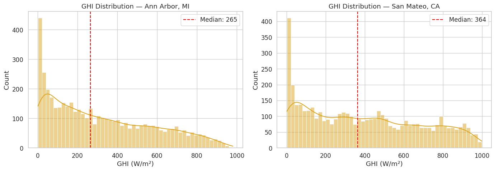 | 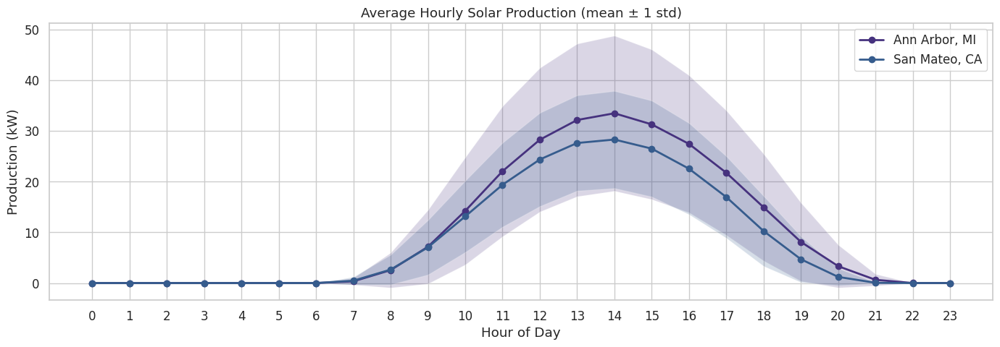 |
| **Chart 1:** GHI distribution for Ann Arbor (median 265 W/m²) vs San Mateo (median 364 W/m²) — Michigan receives ~27% less solar irradiance | **Chart 2:** Average hourly production curve (mean ± 1 std). Peak at 1-2pm, Ann Arbor peaks higher but with wider variance |
| 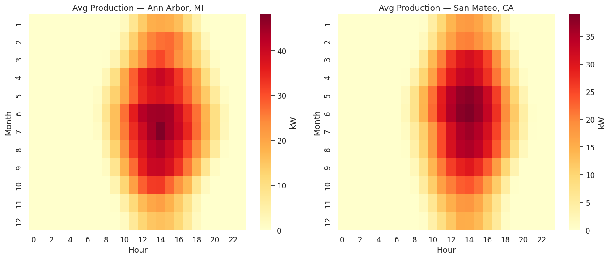 | 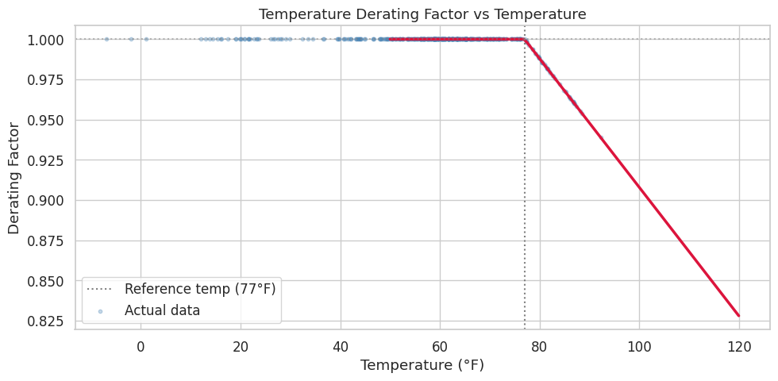 |
| **Chart 3:** Month × hour production heatmaps. Ann Arbor peaks June-July at 45+ kW midday. San Mateo has a broader, flatter production season | **Chart 4:** Temperature derating factor from the original data generation run. It is flat at 1.0 below 77°F, then declines 0.4% per °F. The physical coefficient is about 0.4% to 0.5% per °C, so that run overstated thermal loss. As of November 20, 2026, the code applies 0.4% per °C above 25°C. This chart image predates that fix and needs regeneration (see Known Limitations). |

### Environmental Correlations

| | |
|:---:|:---:|
| 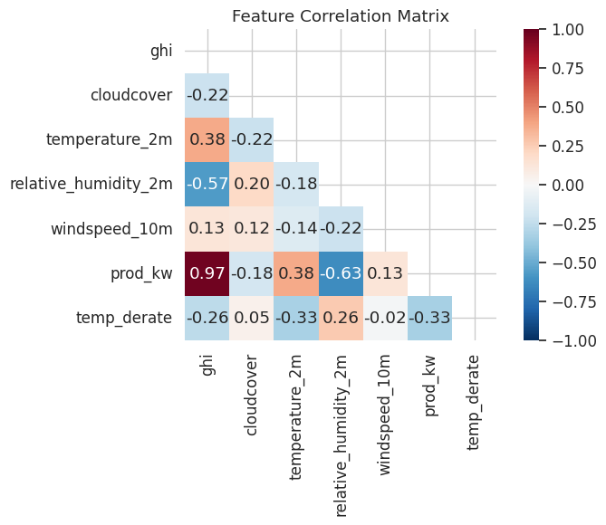 | 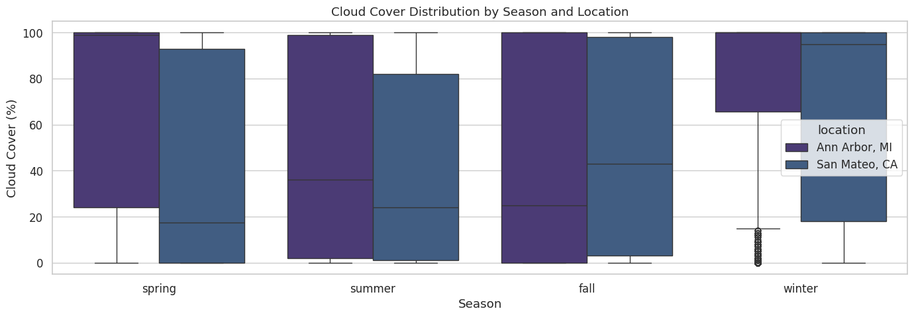 |
| **Chart 5:** Feature correlation matrix. GHI→production r=0.97 (near-perfect). Humidity→GHI r=−0.58 (clouds trap moisture). Cloud cover weakly anti-correlated with GHI (r=−0.21) because GHI captures direct + diffuse radiation | **Chart 6:** Cloud cover distribution by season and location. Ann Arbor consistently cloudier than San Mateo across all seasons |
| 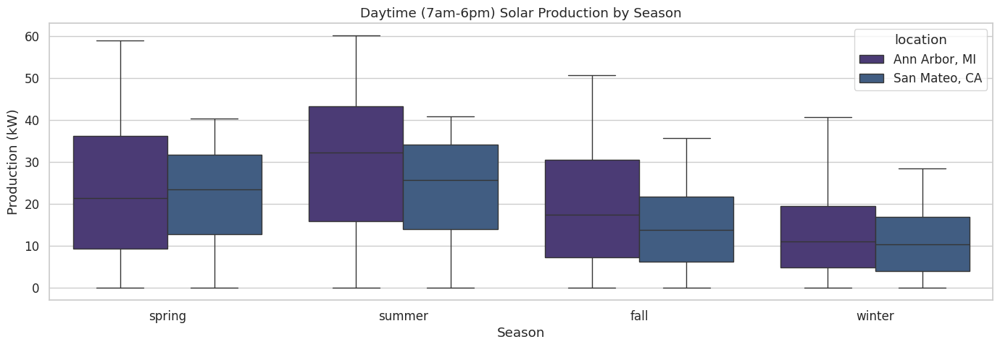 | 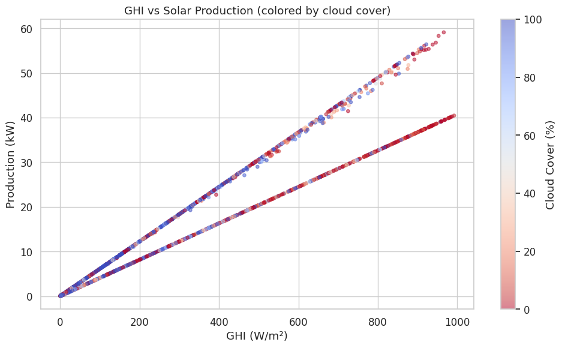 |
| **Chart 7:** Daytime production values by season in the generated data. | **Chart 8:** Generated GHI and production values form separate clear and cloudy bands. |

### Cross-Validation & Grid Analysis

| | |
|:---:|:---:|
| 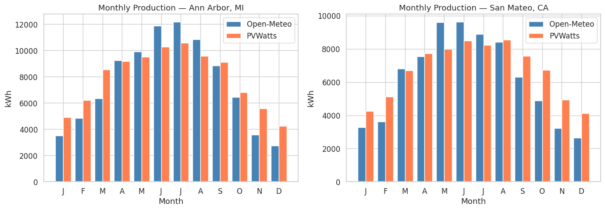 | 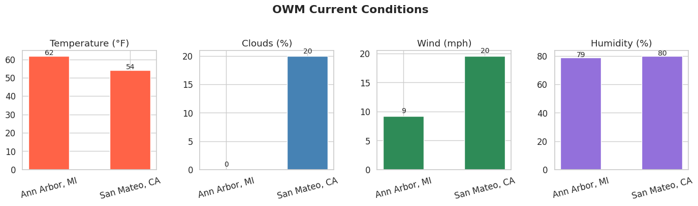 |
| **Chart 9:** Monthly output from the project formula and PVWatts follows a similar seasonal pattern. The project formula contains the documented temperature derating bug, so this chart does not validate it. | **Chart 10:** OWM conditions captured during data generation, including temperature, clouds, wind and humidity. |
| 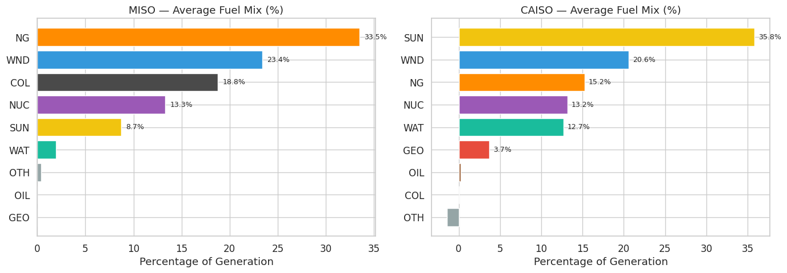 | 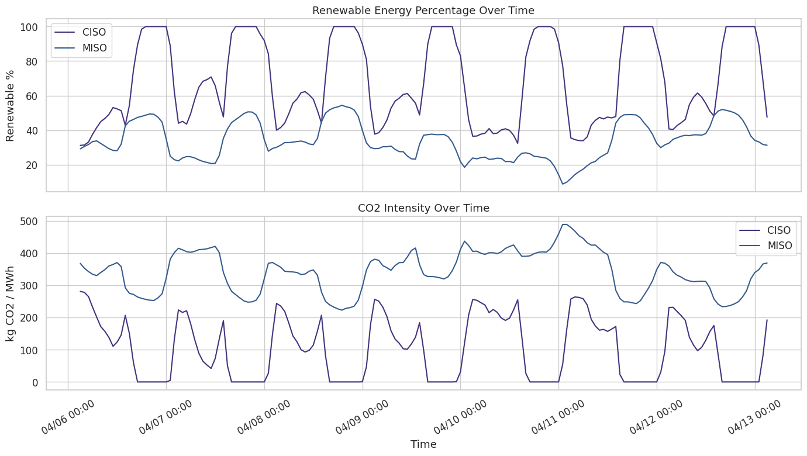 |
| **Chart 11:** Fuel mix values captured for MISO and CAISO during data generation. | **Chart 12:** Renewable share and CO2 intensity values captured over one week. |

### Atmospheric Decomposition

| | |
|:---:|:---:|
| 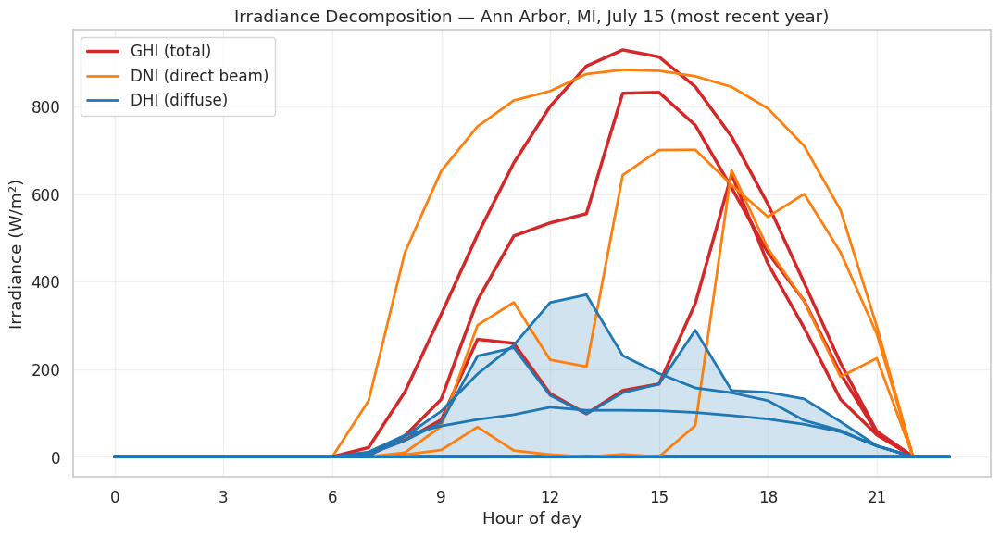 | 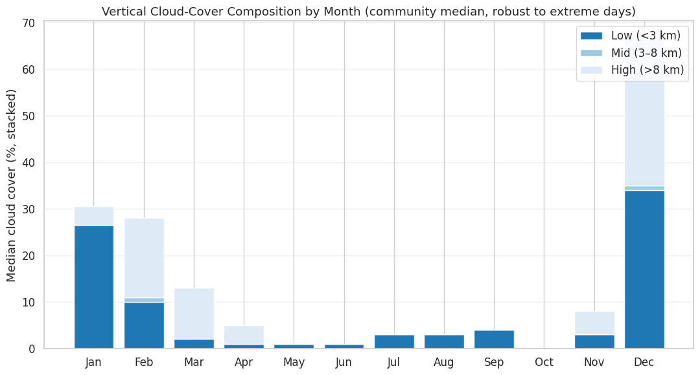 |
| **Chart 13:** The generated data includes GHI, DNI and DHI fields for one clear summer day. | **Chart 14:** The chart summarizes generated low, middle and high cloud cover fields by month. |

---

## Setup

### Google Colab (recommended)

1. Open `solarhive_inference.ipynb` in Google Colab
2. Runtime → Change runtime type → GPU (the archived runs used an RTX PRO 6000)
3. Secrets: add `OWM_API_KEY`, `EIA_API_KEY`, `NREL_API_KEY` and, optionally, `HF_TOKEN`. The dataset and weights are public, so an HF token is optional.
4. Mount Google Drive (for LoRA adapter cache)
5. Run cells sequentially

> **Note:** In the May 2026 run (notebook 3), the 26B A4B BF16 merged
> model used 52.4 GB of GPU memory and the NF4 model used 49.2 GB on one
> GPU. T4 x2 (32 GB) cannot run this model. This README previously said
> that BitsAndBytes NF4 cannot offload to CPU. The NF4 model card says
> it can load with `device_map="auto"`. This conflict is not resolved.

### Multi-Variant Inference Benchmark

`solarhive_inference.py` / `.ipynb` §13 loads each of the 5 published v2 weight
artifacts in turn (the GGUF variant was skipped in the archived Colab run and ran separately on a laptop) (with VRAM cleanup between variants) and runs the same
10-question benchmark (5 Q&A + 5 tool-calling) against each. A single Colab Pro
G4 VM (96 GB VRAM) can run all five in one ~85–105 min session. Each variant
has a `_RUN_<variant>` skip flag so you can opt out of slow ones.

| # | Variant | HF repo | Loader | Format on disk | Size |
|---|---------|---------|--------|----------------|-----:|
| 1 | **E4B LoRA + base** | [`solarhive-e4b-lora`](https://huggingface.co/Truthseeker87/solarhive-e4b-lora) | Unsloth `FastVisionModel` (BF16) | LoRA adapters over kagglehub-cached base | ~200 MB |
| 2 | **E4B merged** | [`solarhive-e4b-ollama`](https://huggingface.co/Truthseeker87/solarhive-e4b-ollama) | transformers BF16 | LoRA-merged BF16 safetensors, single file | ~16 GB |
| 3 | **E4B GGUF** (Ollama) | [`solarhive-e4b-gguf`](https://huggingface.co/Truthseeker87/solarhive-e4b-gguf) | Ollama HTTP `/api/generate` (raw mode) | Q4_K_M GGUF | ~5 GB |
| 4 | **A4B merged** | [`solarhive-26b-a4b-merged`](https://huggingface.co/Truthseeker87/solarhive-26b-a4b-merged) | transformers BF16 | LoRA-merged BF16 safetensors, sharded into 2 files (49.9 + 1.7 GB + `model.safetensors.index.json`) | ~52 GB |
| 5 | **A4B NF4** | [`solarhive-26b-a4b-nf4`](https://huggingface.co/Truthseeker87/solarhive-26b-a4b-nf4) | transformers direct load (no `BitsAndBytesConfig`) | NF4 pre-quantized safetensors, single file | ~48 GB |

> **"Merged" vs "sharded":** orthogonal concepts. *Merged* = the LoRA delta is
> fused into the base weights (vs. kept as a separate adapter applied at load
> time). *Sharded* = the safetensors file is split across multiple parts
> because it exceeds HF's default ~5 GB shard size. Both `solarhive-e4b-ollama`
> and `solarhive-26b-a4b-merged` are LoRA-merged in the same sense; only the
> A4B (~52 GB) is large enough to be sharded. `from_pretrained` handles the
> shard index transparently — sharding is invisible to inference code.

A4B LoRA + base ([`solarhive-26b-a4b-lora`](https://huggingface.co/Truthseeker87/solarhive-26b-a4b-lora))
is the default load in the inference notebook and is benchmarked alongside the When2Call cell; it is therefore not duplicated as an explicit multi-variant entry. Local caches under the user's Drive are checked before HF for every variant — re-runs in the same session skip ~70 GB of HF downloads.

#### Multi-Variant Deployment Validation

Two benchmarking setups cover the six deployment variants of the same SolarHive fine-tune. The cloud results are in notebook 3. The GGUF results file is not committed.

- **5 cloud transformers variants** were measured on Colab Pro G4 (NVIDIA RTX PRO 6000 Blackwell, 96 GB VRAM).
- **1 GGUF variant** was measured locally on a CPU-only Microsoft Surface Pro 8 (11th-gen Intel Core i5-1135G7 @ 2.4 GHz, 16 GB RAM, Intel Iris Xe unused), with the 5.34 GB GGUF + Ollama blob cache stored on an external USB drive.

Sampling defaults across all variants: `temperature=1.0, top_p=0.95, top_k=64` — [Unsloth-recommended](https://unsloth.ai/docs/models/gemma-4) Gemma 4 values.

| # | Variant | Q&A (recorded, not graded) | Tool | When2Call | Total (Q&A + Tool) | Backend | Hardware | Source |
|---|---------|:-:|:-:|:-:|:-:|---|---|---|
| — | A4B LoRA + base (baseline) | 5/5 | 4/5 | **3/3** | **9/10** | transformers + Unsloth | Colab Pro G4 GPU | Notebook 3, cells 31 and 33 |
| 1 | E4B LoRA + base | 5/5 | **5/5** | 2/3 | **10/10** | transformers + Unsloth | Colab Pro G4 GPU | Notebook 3, cell 39 |
| 2 | E4B merged | 5/5 | 4/5 | 2/3 | **9/10** | transformers BF16 | Colab Pro G4 GPU | Notebook 3, cell 41 |
| 3 | **E4B GGUF** | 5/5 | **5/5** | **2/3** | **10/10** | **Ollama HTTP raw + manual prompt builder** | **CPU-only Surface Pro 8 (i5-1135G7, 16 GB RAM, external USB drive for GGUF)** | Local Ollama harness run. Results file not committed. |
| 4 | A4B merged | 5/5 | 4/5 | **3/3** | **9/10** | transformers BF16 | Colab Pro G4 GPU | Notebook 3, cell 45 |
| 5 | A4B NF4 | 5/5 | 4/5 | **3/3** | **9/10** | transformers NF4 (BnB) | Colab Pro G4 GPU | Notebook 3, cell 47 |

The Q&A column is not graded. The script records 5 of 5 for every variant once it generates five answers. Only the Tool and When2Call columns are scored by code. All scores come from the final May 2026 run, except the GGUF row.

The TQ5 multi-call probe (*"Compare today's irradiance forecast across Ann Arbor, Phoenix, Seattle"*) uses lenient scoring (`min_calls=2`) and is the discriminator for the 5/5 vs 4/5 tool-routing column. Only E4B LoRA + E4B GGUF chained the multi-city tool calls; the four 4/5 variants selected a single grounded answer ("forecasts vary by location") rather than chaining lookups. Each variant ran once at temperature 1.0. A repeated run would show how stable the result is.

**Cross-variant observations from one run:**

- Within each family, the variants scored the same on the three When2Call probes. The A4B variants scored 3 of 3. The E4B variants scored 2 of 3.
- The E4B GGUF failed a different probe than the cloud E4B variants. The cloud E4B variants failed probe (c). The GGUF failed probe (d).
- Three probes and one run are too few to call any step lossless or to attribute the gap to model size.
- The E4B GGUF on a CPU only laptop matched the cloud E4B LoRA on the tool routing column (5 of 5). The cloud GPU was an RTX PRO 6000, not an A100.

#### Inference-time When2Call Validation

The probe categories come from [Ross et al. 2025, *When2Call*, arXiv:2504.18851](https://arxiv.org/abs/2504.18851). The probes are not held out. Close paraphrases of all three appear in the training data. The matcher is a lenient keyword check (`solarhive_inference.py` lines 1232 to 1252). In the May 2026 final inference run (notebook 3), all five cloud variants were measured directly on the three probes in a single run. The GGUF variant was measured separately with the local Ollama harness. Its results file is not committed.

The Hugging Face model cards currently label some of these cloud results "inferred". Notebook 3 shows them as measured. This conflict is not yet resolved.

| Variant | Backend | (b) tool routing | (c) follow-up question | (d) refuse + redirect | Nominal | Source |
|---|---|:-:|:-:|:-:|:-:|---|
| **A4B LoRA** (baseline) | transformers + Unsloth, Colab Pro GPU | ✅ | ✅ | ✅ | **3/3** | measured in a single run (notebook 3, cell 33) |
| **E4B LoRA + base** | transformers + Unsloth, Colab Pro GPU | ✅ | ❌ (auto-filled location) | ✅ | **2/3** | measured in a single run (notebook 3, cell 39) |
| **E4B merged** | transformers BF16, Colab Pro GPU | ✅ | ❌ (auto-filled location) | ✅ | **2/3** | measured in a single run (notebook 3, cell 41) |
| **E4B GGUF** | Ollama HTTP raw + manual prompt builder, CPU-only Surface Pro 8 | ✅ | ✅ | ❌ (called `get_weather` on AQI probe) | **2/3** | separate Ollama harness run; results file not committed |
| **A4B merged** | transformers BF16, Colab Pro GPU | ✅ | ✅ | ✅ | **3/3** | measured in a single run (notebook 3, cell 45) |
| **A4B NF4** | transformers NF4 (BnB), Colab Pro GPU | ✅ | ✅ | ✅ | **3/3** | measured in a single run (notebook 3, cell 47) |

**Observations from one run:**

- The A4B LoRA, merged BF16 and NF4 variants all scored 3 of 3.
- The E4B LoRA and merged variants failed probe (c). The E4B GGUF passed (c) and failed (d). All three E4B variants scored 2 of 3.
- Three probes, one run and a lenient matcher cannot show that a merge or quantization step is lossless. They also cannot show that the gap comes from model size.
- The A4B LoRA passed probe (c) in notebook 3, cell 33, with a reply that filled in Ann Arbor figures. That is the behavior the probe is meant to reject. The GGUF harness comment also records a strict score of 1 of 3 for E4B merged (`solarhive_inference_e4b_gguf_ollama.py` line 1561).

A4B stated that it had no air quality tool and offered to check weather data instead. E4B also declined that request and did not fabricate data. The cloud E4B variants failed only probe (c) in this run.

**Finding for deployment:** On these probes, the cloud E4B variants failed probe (c) and the E4B GGUF failed probe (d). The A4B variants passed all three. The result is consistent with the idea that smaller models more readily fill in missing parameters. It does not confirm that idea. **Routing hypothesis (not established):** A4B in the cloud may suit under specified or out of scope queries, and E4B on the edge may suit well specified, in scope routing. Three probes in a single run cannot support a routing rule. A larger held out probe set would need to test it. A future fine-tune could increase E4B's *follow-up clarification* example count (currently 6) and *unable-to-answer* count (currently 10) to close the gap.

#### Caveat — Multi-Token Prediction (MTP) drafters: future iteration, not in the measured numbers above

> *🎂 Quick note: May 5, 2026 happens to be my birthday. So when Google announced "MTP drafters for Gemma 4" that morning, it landed like an unusually well-timed birthday gift — but the same timing also explains this caveat. I'd already finished my final inference run before the drafters dropped, so I'm treating MTP integration as a deliberate next iteration rather than folding it back into the submission's measured numbers.*

**What is speculative decoding?** Standard transformer decoding runs serially — generating *K* tokens takes *K* sequential forward passes through the target model, each one waiting on the last. Leviathan, Kalman & Matias (2023) introduced *speculative decoding* in [*Fast Inference from Transformers via Speculative Decoding*](https://arxiv.org/abs/2211.17192) (ICML 2023) to break that serial chain without changing the output distribution under argmax decoding. A much smaller "drafter" model M<sub>q</sub> generates γ candidate tokens autoregressively in roughly the time the target M<sub>p</sub> would take to produce one; the target then verifies *all* γ candidates in a **single parallel forward pass**. The algorithm keeps every accepted candidate, and if any get rejected it resamples that one position from a corrected distribution using the paper's *speculative sampling* procedure. The math guarantees the output distribution stays **identical** to standard decoding — no quality loss, just speedup. The original paper reports **2×–3× walltime speedup on T5-XXL** with bit-identical outputs.

The intuition I keep in mind: large-model inference usually bottlenecks on memory bandwidth, not compute, so spare flops sit idle on most steps. The drafter spends those flops productively — it trades a small extra compute budget for much better serial throughput. For the tokens that are easy to predict (which is most of them), the drafter and target agree, and I land many tokens per target call.

**What Google shipped on May 5, 2026.** [*"Accelerating Gemma 4: faster inference with multi-token prediction drafters"*](https://blog.google/innovation-and-ai/technology/developers-tools/multi-token-prediction-gemma-4/) (Lacombe & Grootendorst). Google published paired drafter checkpoints for all four IT-tuned Gemma 4 variants — `gemma-4-E2B-it-assistant`, `gemma-4-E4B-it-assistant`, `gemma-4-26B-A4B-it-assistant`, `gemma-4-31B-it-assistant` — discoverable via the [`google/gemma-4` Hugging Face collection](https://huggingface.co/collections/google/gemma-4) and on [Kaggle Models](https://www.kaggle.com/models/google/gemma-4) ([@GoogleGemma announcement](https://x.com/googlegemma/status/2051694045869879749)). The drafter that pairs with the cloud target `google/gemma-4-26B-A4B-it` is `google/gemma-4-26B-A4B-it-assistant` (~0.4 B params). Per the [MTP overview](https://ai.google.dev/gemma/docs/mtp/overview), the drafters share the input embedding table with their paired target and consume the target's last-layer activations — which is what keeps them lightweight and pushes acceptance rate high. Google reports speedups of **up to 3× decode with no quality degradation** on the 26B-A4B configuration, and **~2.2×** on Apple Silicon at batch sizes 4–8. Tested runtimes named in the blog: **LiteRT-LM, MLX, Hugging Face Transformers, vLLM, SGLang, Ollama**.

**Hugging Face Transformers integration is one extra kwarg:**

```python
target    = AutoModelForCausalLM.from_pretrained("Truthseeker87/solarhive-26b-a4b-merged", dtype=torch.bfloat16, ...)
assistant = AutoModelForCausalLM.from_pretrained("google/gemma-4-26B-A4B-it-assistant", dtype=torch.bfloat16, ...)
target.generate(**inputs, assistant_model=assistant)  # MTP enabled
```

Two optional knobs are also exposed: `num_assistant_tokens` (the γ parameter from the paper) and `num_assistant_tokens_schedule = "heuristic" | "constant"` for dynamic adjustment. The `"heuristic"` schedule increases γ by 2 when the target accepts every draft token and decreases by 1 whenever it rejects any — a runtime adaptation that maps directly to the paper's Section 3.5 suggestion of varying γ during inference.

**Scope of the measurements:** The cloud and GGUF runs used standard autoregressive decoding. SolarHive did not measure MTP speedup or decode latency for those variants.

**Future iteration.** The MTP integration ships as a gated cell (`§14`, `_RUN_MTP_DEMO = False`) in [`solarhive_inference.py`](solarhive_inference.py) so reviewers can audit and reproduce the path; it is deliberately kept out of the measured benchmark numbers above. **The cell's target loads [`Truthseeker87/solarhive-26b-a4b-merged`](https://huggingface.co/Truthseeker87/solarhive-26b-a4b-merged)** paired with Google's released base-paired drafter [`google/gemma-4-26B-A4B-it-assistant`](https://huggingface.co/google/gemma-4-26B-A4B-it-assistant). Per Leviathan, Kalman & Matias 2023, correctness is invariant to drafter quality — the target's verification step preserves the exact output distribution regardless of what the drafter proposes. What can vary is **acceptance rate α**, since the released drafter was trained against the base `gemma-4-26B-A4B-it`, not against the LoRA-fine-tuned merged target. **Measured α and the resulting walltime speedup against a domain-fine-tuned target are the planned post-hackathon contribution.** A documented post-hackathon trajectory — drafter distillation against the SolarHive merged target plus a cross-variant α-measurement table across the cloud and edge artifacts — is sketched in the project's research notes; the cross-runtime story (LiteRT-LM, MLX, vLLM public APIs for paired drafters are still landing) is part of the same iteration.

#### Run-history archive

The full execution notebooks (cell-by-cell outputs from the runs that produced the benchmark numbers above) are preserved in [`archive/final_run/`](archive/final_run/) for reproducibility audit:

| Notebook | What it contains |
|---|---|
| [`1_solarhive_datagen_finalrun_Apr2026.ipynb`](archive/final_run/1_solarhive_datagen_finalrun_Apr2026.ipynb) | Synthetic-corpus generation execution log — produces the 1,727-row v2 multimodal training set (1,713 text + 14 image-grounded; 1,530 unique Q&A; 183 tool-calling with When2Call decomposition 106/53/10/6/8) plus the 14 diagnostic charts catalogued in [`datagen_charts/`](datagen_charts/); upstream of the dataset published at [`Truthseeker87/solarhive-community-solar-multimodal`](https://huggingface.co/datasets/Truthseeker87/solarhive-community-solar-multimodal) |
| [`2_solarhive_finetune_finalrun_Apr2026.ipynb`](archive/final_run/2_solarhive_finetune_finalrun_Apr2026.ipynb) | Dual fine-tune execution log — 26B A4B + E4B Unsloth LoRA training on Colab Pro G4 (NVIDIA RTX PRO 6000 Blackwell 102 GB total / 94.97 GB max usable per Unsloth), converged loss + step-by-step training output |
| [`3_solarhive_inference_finalrun_May2026.ipynb`](archive/final_run/3_solarhive_inference_finalrun_May2026.ipynb) | Multi-variant cloud inference run: 5 transformers variants (A4B LoRA / E4B LoRA / A4B+E4B merged / A4B NF4) on Colab Pro G4 with the 10-question benchmark (5 Q&A recorded, not graded, plus 5 tool prompts). When2Call probes were measured in a single run on all five cloud variants: A4B LoRA, A4B merged and A4B NF4 scored 3/3, and E4B LoRA and E4B merged scored 2/3 (see the table above). |
| [`4_solarhive_e4b_cactus_finalrun_May2026.ipynb`](archive/final_run/4_solarhive_e4b_cactus_finalrun_May2026.ipynb) | Cactus mobile-runtime conversion log — `cactus convert ... --precision INT4` on Colab Pro CPU + High-RAM produces a 6.94 GB INT4 multimodal artifact (audio Conformer + vision encoder retained FP16) with CosSim 0.9946 / SNR 19.8 dB / MSE 5.18e-04 fidelity. Build step + Python SDK smoke test gracefully skip on the x86 host (Cactus C++ engine is ARM-only by design); deployable to the Flutter Android companion app |
| [`5_solarhive_e4b_litert_finalrun_May2026.ipynb`](archive/final_run/5_solarhive_e4b_litert_finalrun_May2026.ipynb) | LiteRT-LM Python runtime demo. It loads the upstream pre-converted base Gemma 4 E4B `.litertlm` (3.66 GB, downloaded in 22.5s) from [`litert-community/gemma-4-E4B-it-litert-lm`](https://huggingface.co/litert-community/gemma-4-E4B-it-litert-lm), Engine cold-start 15.32s, warmup TTFT 2.63s. **Q&A 8/8** with **9/9 native curly-wrapped tool calls (0 parens drift)**, decode 8.29 tok/s on Colab x86_64 CPU (median over the 8-prompt benchmark), with a median time to first token of 41.38 s per prompt. MTP probe graceful-skips with the architecturally correct *"drafter pairing required"* message; VQA graceful-skips on auth (the sky-photo dataset was private at the time of the run); When2Call 1/3 by the automated scorer (a manual review judged the probe (d) refusal correct, but the scorer keyword list missed *"do not"*). Runs only on x86 Linux. Other platforms are untested. |

For the 6th deployment variant (local-laptop CPU GGUF via Ollama), see [`solarhive_inference_e4b_gguf_ollama.py`](solarhive_inference_e4b_gguf_ollama.py) at the project root. It is a runnable pytest harness that produces the GGUF benchmark + an auto-generated MD report when run against a local Ollama instance. The report from the GGUF run cited in this README is not committed.

#### Model size context

Google reports higher base model benchmark scores for 26B A4B than for E4B on MMLU Pro, MMMU Pro, AIME 2026 and LiveCodeBench v6 ([Gemma 4 model card](https://gemma.ai/models/gemma-4/model-card/)). These upstream scores do not predict SolarHive When2Call behavior.

In one SolarHive run, the A4B variants scored 3 of 3 and the E4B variants scored 2 of 3 on three lenient probes. The probes were not held out. This result does not establish a scaling relationship or a deployment routing rule.

**Defensive dispatch:** the May 2026 validation run executed without `TypeError` from hallucinated tool kwargs (the `_safe_tool_call` defensive dispatcher in Cell 3 filters argument lists against each function's signature) or `KeyError` from pure-tool model responses (the `parsed.get("content", "")` pattern at all four `parse_response()` callsites returns the empty string when the response is tool-only). No regression tests for these safety nets are committed to this repository.

### API Keys Required (all free tier)

| Service | Portal | Free Tier |
|---------|--------|-----------|
| OpenWeatherMap | [openweathermap.org/api](https://openweathermap.org/api) | 1,000 calls/day |
| EIA Open Data | [api.eia.gov](https://www.eia.gov/opendata) | Free key. EIA documents throttling. See the provider's rate limits. |
| NREL PVWatts | [developer.nlr.gov](https://developer.nlr.gov/docs/solar/pvwatts/v8/) | Free key. See the provider's rate limits. The old developer.nrel.gov host stopped serving requests on May 29, 2026. As of November 20, 2026, the code calls developer.nlr.gov. Existing API keys work on the new host (see Known Limitations). |

### Local Deployment via Ollama

The recommended path for a 16 GB laptop is the
[`solarhive-e4b-gguf`](https://huggingface.co/Truthseeker87/solarhive-e4b-gguf)
Q4_K_M GGUF with `solarhive_inference_e4b_gguf_ollama.py`. The
safetensors recipe below requires 24 GB or more of system RAM. The
[`solarhive-e4b-ollama`](https://huggingface.co/Truthseeker87/solarhive-e4b-ollama)
model card warns that it runs out of memory on 16 GB.

```bash
# Download merged safetensors from HuggingFace
git clone https://huggingface.co/Truthseeker87/solarhive-e4b-ollama
cd solarhive-e4b-ollama

# Create Modelfile (FROM . points to safetensors in current directory)
cat > Modelfile << 'EOF'
FROM .
SYSTEM "You are SolarHive, an AI energy advisor for a community of 12 homes with rooftop solar and shared battery storage in Ann Arbor, Michigan."
PARAMETER temperature 1.0
PARAMETER top_p 0.95
PARAMETER top_k 64
PARAMETER num_ctx 4096
EOF

# Import model (--experimental required for Gemma 4 safetensors)
ollama create solarhive --experimental -f Modelfile
ollama run solarhive "What's the best time to run my dishwasher today?"
```

**Local inference:** Running via Ollama keeps prompts on the device.
Live data still comes from cloud APIs. Local inference is slower than
the cloud GPU path.

### Training Provenance

Published weights on Hugging Face (`Truthseeker87/solarhive-*`) were
trained with **Unsloth `2026.4.5`** on Colab Pro (NVIDIA RTX PRO 6000
Blackwell, 96 GB GDDR7) in April 2026. `solarhive_finetune.py` pins
`unsloth==2026.4.5` to match the version used for training. Exact
deterministic reproduction has not been tested. The May 2026 inference
run used Unsloth `2026.4.8` (notebook 3). Later Unsloth releases
contain ongoing kernel and optimizer patches that may shift loss
trajectories slightly. Keep the pin at `2026.4.5` to stay closest to
the published training setup, or bump it if you prefer the latest
upstream fixes.

### Notebook Provenance Note (April 25, 2026)

`solarhive_finetune.py` was audited against the official Unsloth Gemma 4
documentation
([overview](https://unsloth.ai/docs/models/gemma-4),
[training guide](https://unsloth.ai/docs/models/gemma-4/train),
[bug fixes & tips](https://unsloth.ai/docs/models/gemma-4/train#bug-fixes--tips))
and four classes of forward-only edit were applied to align the notebook
with documented best practices: explicit loader arguments
(`max_seq_length`, `dtype`, `full_finetuning`), explicit `SFTConfig`
arguments (`weight_decay`, `lr_scheduler_type`, `max_grad_norm`), and an
E4B chat-template switch from `gemma-4-thinking` to `gemma-4` per
Unsloth's per-variant recommendation (Tip #1: thinking template is for
26B/31B reasoning-class variants). 26B A4B retains
`chat_template="gemma-4-thinking"` because Tip #1 specifies it for that
variant size.

### Fine-Tuning Architecture — Text-Only on the Multimodal-Capable Corpus

**The shipped fine-tune is text-only.** The training corpus carries
both text rows and an image-grounded subset (14 Q&A turns from 7
manually-labeled Ann Arbor sky photographs) at the schema level, but
image rows are skipped at the data-prep layer; the training pipeline
pre-renders only text rows for TRL's default text collator.

**VQA at inference time uses the base Gemma 4 model's pretrained
vision encoder** — ~150M parameters for E4B and ~550M for 26B A4B per
the [official model card](https://ai.google.dev/gemma/docs/core/model_card_4).
Our LoRA targets only the language-model linear layers
(`target=all-linear`); the vision tower is not modified. This matches
the Vertex AI Gemma 4 SFT recipe documented in the
[Hugging Face blog](https://huggingface.co/blog/gemma4), which
explicitly freezes both vision and audio towers during text-focused
fine-tuning. (Multimodal fine-tuning is deferred post-hackathon and
would require a real image corpus plus a held-out VQA benchmark; the
dataset's image schema is preserved so a future multimodal fine-tune
can re-enable image rows without changing the corpus.)

The training dataset is the canonical
[`solarhive-community-solar-multimodal`](https://huggingface.co/datasets/Truthseeker87/solarhive-community-solar-multimodal)
repository (1,727 rows). `LEGACY_DATA` and `LEGACY_TOOL_CALL_DATA` in `solarhive_datagen.py` Cell 7a preserve the hand written rows in source control. A current data generation rerun requires the NLR host fix described in Known Limitations. Exact reproduction has not been tested.

The canonical dataset holds **1,713 text rows + 14 image-grounded Q&A
turns** from 7 Ann Arbor sky photographs. Image-corpus sourcing went
through two earlier rejections: the SWIM corpora from the National
University of Singapore (CC BY-NC licensing + registration-gated
download) and the NREL Solar Radiation Research Laboratory's legacy
Sky Imager archive (stopped publishing raw images in May 2017).
Neither offered a license-compatible direct download; the shipped
image set is smaller than originally planned but every label is
human-confirmed and every paired Q&A is grounded in the same
temperature-derated GHI formula used throughout the dataset.

Tool-calling coverage now includes realistic *follow-up clarification*
and *unable-to-answer* categories following Ross et al. (2025)
[*When2Call: When (not) to Call Tools*](https://arxiv.org/abs/2504.18851).

Multi-step planning answers (weekly summaries, seasonal maintenance
plans, annual reports) report aggregate production using both an
**average** (mean over daylight hours, composes correctly with cost
and CO2 calculations) and a **typical** value (median over daylight
hours, robust to skew). This avoids the misleading 24-hour mean that
would otherwise halve visible efficiency by including 12 hours of
nighttime zeros.

This versioning keeps the v1 benchmarks bound to the specific weights
they describe, while v2 repositories can publish new text benchmarks
without rewriting v1 history.

---

## Real-World Impact

### Scope of the impact claims

Earlier versions of this section listed curtailment, CO2, price and
return figures without sources. Those figures were removed. This
project has not measured any change in self consumption, cost or
emissions.

What the project did measure: the NREL PVWatts baseline for the modeled
72 kW Ann Arbor array is 94,501 kWh per year (notebook 1). Any savings
or emissions estimate built on that figure would be a scenario, not a
result. It would need a cited self consumption rate, a cited grid
emissions factor and a cited retail and export price.

### Possible users

**Homeowners** could use the advisor to time loads to solar production.
The value depends on local retail and export prices, which this project
did not study.

**Community solar developers and HOAs** could use it to coordinate
across households.

**Utilities** could gain visibility into rooftop solar production. The
prototype does not read real meters.

**Battery storage companies** (Tesla Powerwall, Enphase, etc.) could
pair it with charge and discharge planning. The prototype battery is a
simulator.

**Insurance and real estate** users might want resilience data. The
project has not produced such data.

---

## What SolarHive Does NOT Solve

SolarHive is an open source learning prototype for community solar advice. It does not optimize or control real energy equipment. This section lists what it does not do:

- **Does not change the fundamental physics of solar cell efficiency.**
  The Shockley–Queisser theoretical limit of ~33% for single-junction
  cells remains. SolarHive cannot make a 20%-efficient panel produce
  at 40%.

- **Does not manufacture batteries or fuel cells.** Community-based
  storage hardware must be sourced, installed, and maintained
  separately.

- **Does not build physical grid infrastructure.** Wiring,
  transformers, and interconnection agreements between households
  require separate engineering and permitting.

- **Does not replace utility grid management.** The prototype models 12 homes. It has not been tested with a real community or utility.

- **Does not control real equipment.** The battery is a simulator. The
  prototype does not read real meters or dispatch real storage.

SolarHive aims to help communities use existing infrastructure better
through information and coordination. This project has not measured
that effect.

> *It does not change the physics of solar panels.
> It aims to change how communities use what those panels produce.*

---

## Known Limitations

**Evaluation**

- The Q&A half of every 8/8, 9/10 and 10/10 score is not graded. The
  script records 5 of 5 once it generates five answers. Only tool
  routing and When2Call are scored by code.
- The 8/8 score comes from an earlier check in the April 2026 fine tune
  notebook. The 9/10 and 10/10 scores come from the final May 2026
  inference run. The two checks use different tool prompts.
- The When2Call probes are close paraphrases of training rows. They use
  a lenient keyword matcher. They are not held out.
- Each benchmark ran once at temperature 1.0. The test sets are small
  (5 tool prompts and 3 When2Call probes).
- No validation loss was measured. The training losses of the two
  models do not compare model quality.
- VQA was not scored. The fine tune is text only. The May 2026 VQA tests
  used synthetic placeholder images.
- The GGUF results file and the on device log are not committed. The
  earlier NF4 8 question check has no notebook in this repository.
- The Hugging Face model cards label some When2Call results "inferred".
  Notebook 3 shows them as measured in a single run. Several card
  sizes, scores and probe descriptions also conflict with the archived
  runs.

**Deployment**

- The Hugging Face Space is paused.
- The on device result is one prompt on one phone, with about 54
  seconds per reply.
- The LiteRT result uses the upstream base model, not the fine tune. It
  ran only on an x86 Colab CPU, with a median time to first token of
  41.38 seconds.
- Jetson, Raspberry Pi, iOS and the browser app are untested.
- The NF4 variant used 49.2 GB of GPU memory in the May 2026 run. The
  NF4 file is 48.34 GB on disk. It does not fit a 16 GB or 40 GB GPU in
  a single GPU load.

**Known issues fixed in code that still need a rerun**

- **Temperature derating used the wrong unit.** The original code
  applied 0.4% loss per °F above 77°F. The physical coefficient is
  about 0.4% to 0.5% per °C, so the original code overstated thermal
  loss. As of November 20, 2026, the code converts the temperature to
  Celsius and applies 0.4% loss per °C above 25°C (77°F), with the same
  0.75 floor: `max(0.75, 1.0 - 0.004 * max(0, temp_c - 25))`. The fix
  covers `solarhive_datagen.py`, `solarhive_finetune.py`,
  `solarhive_inference.py`, `solarhive_e4b_litert_v3.1.py`, the matching
  notebooks and `web-litert/app.js`. The published dataset
  (`Truthseeker87/solarhive-community-solar-multimodal`), the fine-tuned
  models and all reported results came from the old formula. They need
  a dataset regeneration, a new fine tune and a rerun. Several
  hand-written tool examples in `solarhive_datagen.py` (lines 4320,
  4331, 4353, 4548, 4616 and 4632) still hold derating values from the
  old formula and need an update before the regeneration.
- **The NREL API host moved.** The original code called
  `developer.nrel.gov`. That host stopped serving requests on May 29,
  2026 and does not redirect. As of November 20, 2026, the code calls
  `https://developer.nlr.gov/api/pvwatts/v8.json` in
  `solarhive_datagen.py`, `solarhive_inference.py`,
  `solarhive_e4b_litert_v3.1.py` and the matching notebooks. Existing
  API keys keep working on the new host. The published dataset, the
  fine-tuned models and all reported results came from runs against the
  old host and the old derating formula. They need regeneration and a
  rerun.

**Impact**

- The impact section describes possible uses, not measured results.

---

## Compute Strategy

| Task | Platform | GPU |
|------|----------|-----|
| Data generation | Google Colab Pro | RTX PRO 6000 (96 GB) |
| Fine-tuning (dual LoRA) | Google Colab Pro | RTX PRO 6000 (96 GB), BF16 |
| Inference demo | Google Colab Pro | RTX PRO 6000 (96 GB), BF16 |
| Edge deployment | Ollama on laptop | CPU (E4B Q4_K_M GGUF) |

---

## Models & Resources

| Resource | Link | Purpose |
|----------|------|---------|
| **Demo (paused)** | [HF Space](https://huggingface.co/spaces/Truthseeker87/solarhive) | Gradio demo (ZeroGPU). The Space is paused. |
| **26B A4B LoRA** | [solarhive-26b-a4b-lora](https://huggingface.co/Truthseeker87/solarhive-26b-a4b-lora) | Cloud LoRA adapters via Unsloth (Unsloth track) |
| **26B A4B NF4** | [solarhive-26b-a4b-nf4](https://huggingface.co/Truthseeker87/solarhive-26b-a4b-nf4) | Pre-quantized 4-bit cloud model. 48.34 GB on disk. Used 49.2 GB of GPU memory in the May 2026 run. |
| **26B A4B Merged** | [solarhive-26b-a4b-merged](https://huggingface.co/Truthseeker87/solarhive-26b-a4b-merged) | Full BF16 merged cloud model |
| **E4B LoRA** | [solarhive-e4b-lora](https://huggingface.co/Truthseeker87/solarhive-e4b-lora) | E4B adapter weights (~200 MB) — apply over base via Unsloth |
| **E4B safetensors** | [solarhive-e4b-ollama](https://huggingface.co/Truthseeker87/solarhive-e4b-ollama) | Edge model — merged safetensors source for transformers / GGUF conversion via llama.cpp |
| **E4B GGUF** | [solarhive-e4b-gguf](https://huggingface.co/Truthseeker87/solarhive-e4b-gguf) | **Edge deployment.** Q4_K_M GGUF + 992 MB mmproj for Ollama / llama.cpp on 16 GB CPU laptop. 5 of 5 tool routing in one local run (Q&A not graded; results file not committed). (Ollama + llama.cpp tracks) |
| **Dataset** | [solarhive-community-solar-multimodal](https://huggingface.co/datasets/Truthseeker87/solarhive-community-solar-multimodal) | 1,727 training examples (1,713 text + 14 image-grounded) |

---

## Special Technology Tracks

The Special Technology Tracks recognize outstanding technical achievement using specific tools and frameworks within the Gemma 4 ecosystem. Projects are eligible to win both a Main Track Prize **and** a Special Technology Prize. SolarHive targets all five tracks with the same canonical 1,727-row dataset. Four tracks use the SolarHive fine tune. The LiteRT track uses the upstream base E4B model.

| Track | Official description | SolarHive deliverable | Status |
|---|---|---|---|
| **Unsloth** | *"For the best fine-tuned Gemma 4 model created using Unsloth, optimized for a specific, impactful task."* | Dual fine-tune via Unsloth `FastVisionModel` — E4B + 26B A4B LoRA adapters on the SolarHive 1,727-row community-solar corpus. See [`solarhive_finetune.py`](solarhive_finetune.py) and [`solarhive-26b-a4b-lora`](https://huggingface.co/Truthseeker87/solarhive-26b-a4b-lora) / [`solarhive-e4b-lora`](https://huggingface.co/Truthseeker87/solarhive-e4b-lora). | ✅ shipped |
| **Ollama** | *"For the best project that utilizes and showcases the capabilities of Gemma 4 running locally via Ollama."* | E4B Q4_K_M GGUF served through Ollama on a 16 GB CPU laptop with the `/api/generate` raw-mode + manual Gemma 4 prompt builder. It scored 5 of 5 on tool routing and 2 of 3 on the When2Call probes in one local run. The Q&A half was not graded, and the results file is not committed. See [`solarhive_inference_e4b_gguf_ollama.py`](solarhive_inference_e4b_gguf_ollama.py). | ✅ shipped |
| **llama.cpp** | *"For the best innovative implementation of Gemma 4 on resource-constrained hardware."* | E4B Q4_K_M + 992 MB mmproj (vision SigLIP + audio Conformer, 1,411 tensors), full multimodal via `llama-server --mmproj` on resource-constrained hardware. The standard Q4_K_M file (5.34 GB) ran on a 16 GB CPU laptop. A 16 GB laptop needs the PLE override recipe only to create the GGUF, not to run it. The [Jetson Orin Nano Super](https://www.nvidia.com/en-us/autonomous-machines/embedded-systems/jetson-orin/nano-super-developer-kit/) is a planned target and is untested. See [`solarhive-e4b-gguf`](https://huggingface.co/Truthseeker87/solarhive-e4b-gguf). | ✅ shipped |
| **LiteRT** | *"For the most compelling and effective use case built using Google AI Edge's LiteRT implementation of Gemma 4."* | Browser app code in [`web-litert/`](web-litert/) loads the upstream base E4B bundle. The LiteRT-LM Python runtime demo ran the base E4B model on a Colab x86 CPU (notebook 5). No browser test results are published. A fine tuned LiteRT bundle needs a new conversion attempt. | Base model runtime demo run; fine tuned bundle not built |
| **Cactus** | *"For the best local-first mobile or wearable application that intelligently routes tasks between models."* | Native-mobile deployment via [Cactus](https://github.com/cactus-compute/cactus): fine-tuned E4B → INT4 mobile artifact (6.94 GB multimodal, CosSim 0.9946 quant fidelity) loaded by a companion Flutter Android app via the [Cactus Flutter SDK](https://pub.dev/packages/cactus). Convert pipeline run on Colab Pro CPU + High-RAM. See [`solarhive_e4b_cactus.ipynb`](solarhive_e4b_cactus.ipynb). | Convert pipeline run on Colab. Android APK released (v1.0). Tested with one prompt on one Snapdragon 865 device. |

**How the tracks share one fine tune:** the same Unsloth fine tune feeds the merged safetensors source ([`solarhive-e4b-ollama`](https://huggingface.co/Truthseeker87/solarhive-e4b-ollama)). That source becomes the GGUF for llama.cpp and Ollama and the INT4 mobile artifact for Cactus. The fine tune did not produce a LiteRT artifact. The LiteRT tier uses the upstream base E4B bundle.

---

## Hackathon Submission

| Item | Detail |
|------|--------|
| Competition | [The Gemma 4 Good Hackathon](https://kaggle.com/competitions/gemma-4-good-hackathon) |
| Organizers | Google DeepMind x Kaggle |
| Main Track | Global Resilience |
| Special Tech tracks | **Unsloth** + **Ollama** + **llama.cpp** + **LiteRT** + **Cactus** (see table above) |
| Deadline | May 18, 2026 at 11:59 PM UTC |
| Kaggle profile | [melricko](https://kaggle.com/melricko) |
| GitHub | [youshen-lim/the-gemma4-good-hackathon-solarhive](https://github.com/youshen-lim/the-gemma4-good-hackathon-solarhive) |

---

## Corrections (November 20, 2026)

I corrected the following items on **November 20, 2026** after I rechecked this README against the archived notebooks, the code and the Hugging Face pages. The data and models are unchanged. A later commit on November 20, 2026 fixed the two code issues in Known Limitations. The dataset, the models and the reported results still need regeneration and a rerun.

| Item | Previously stated | Corrected to | Cause |
|---|---|---|---|
| Q&A scoring | 5/5 Q&A presented as a graded result inside 8/8, 9/10 and 10/10 | Q&A is recorded as 5/5 by the script, not graded. Only tool routing and When2Call are scored by code. | The script sets Q&A to the number of questions (`solarhive_inference.py` lines 1436 to 1897) |
| Score sources | 8/8 and 9/10 shown without a clear test set | 8/8 is the earlier April 2026 fine tune check. 9/10 and 10/10 are the final May 2026 inference run. | The two checks use different tool prompts |
| When2Call probes | "Held-out" probes | Not held out. Close paraphrases appear in the training data. Lenient keyword matcher. | `solarhive_datagen.py` lines 2717, 5079, 5107 |
| When2Call source labels | Three cloud variants "inferred" by lossless equivalence | Measured in a single run (notebook 3). Hugging Face cards still say "inferred" for some. | Notebook 3, cells 39, 45 and 47 print direct results |
| When2Call paper | 9 to 67% tool hallucination rates on (c) and (d) | Removed. The paper links missing follow up and unable to answer data to higher hallucination. | The range is not stated in the paper and is not per category |
| NF4 memory | About 16 GB; fits A100 40 GB | 49.2 GB GPU memory in the May 2026 run. 48.34 GB on disk. | Notebook 3, cell 47; Hugging Face file listing |
| Merged A4B size | About 48 GB | 51.61 GB on disk | Hugging Face file listing (49.91 GB and 1.70 GB shards) |
| NF4 8/8 result | NF4 scored 8/8, matching merged | NF4 scored 4/5 on tool routing in the May 2026 run, the same as merged. The 8/8 notebook is not committed. | No NF4 8 question run in this repository |
| Cross variant claims | Merge and NF4 "lossless", gap is a "model size signature", "reproducible across runs" | Removed. One run, three probes. | Single run at temperature 1.0 |
| E4B (c) and (d) | E4B regresses on (c) consistently across the family | Cloud E4B failed (c). GGUF failed (d). | Internal contradiction |
| Cloud GPU | A100 class | RTX PRO 6000 Blackwell | Notebook 3, cell 3 |
| Compounding loss | About 34% | About 36% | Arithmetic: 0.70 × 0.60 × 0.95³ |
| Derating chart | Validates the derating formula | The original code used 0.4% per °F, not per °C. The code now uses 0.4% per °C (see the derating formula row). The chart image predates the fix. | `solarhive_datagen.py` line 149 |
| NREL host | developer.nrel.gov, unlimited | developer.nlr.gov. Old host retired May 29, 2026. The code now uses the new host (see the PVWatts endpoint row). | NLR domain transition notice |
| Derating formula in code (November 20, 2026) | `max(0.75, 1.0 - 0.004 * max(0, temp_f - 77))`, 0.4% per °F above 77°F | `max(0.75, 1.0 - 0.004 * max(0, temp_c - 25))` with `temp_c = (temp_f - 32) * 5 / 9`, 0.4% per °C above 25°C. The published dataset, the fine-tuned models and all reported results used the old formula and need regeneration and a rerun. | Panel temperature coefficients are stated per °C |
| PVWatts endpoint in code (November 20, 2026) | `https://developer.nrel.gov/api/pvwatts/v8.json` | `https://developer.nlr.gov/api/pvwatts/v8.json`. Existing API keys keep working. The published dataset and reported results came from runs against the old host and need a rerun. | [NLR domain transition notice](https://developer.nlr.gov/docs/nlr-domain-transition/) |
| API free tiers | EIA and NREL "Unlimited" | Free key; see provider rate limits | EIA documents throttling |
| Training rows | 551 training examples | 1,727 rows | Dataset and notebook 1 |
| E2B vision encoder | About 75M | About 150M | Gemma 4 model card |
| Gemma 4 modalities | E2B and E4B include video | Text, image and audio | Gemma 4 model card |
| MRCR v2 use case | Multi round tool calling context | Long context retrieval | Gemma 4 model card |
| Edge model | E2B is the Ollama target | E4B Q4_K_M GGUF. E2B was not shipped. | Every Ollama result uses E4B |
| 31B comparison | 2 to 3% better, 2 to 4 times slower; 26B A4B captures about 95% of 31B quality | About 3 points better on MMMU Pro and MMLU Pro. 22 points better on MRCR. Speed not measured. | Speed figure had no source |
| Training loss | Best domain absorption | Lowest training loss. No validation loss. | Training loss does not compare models |
| HF Space | Live demo | Paused | Hugging Face Space runtime status |
| LiteRT status | Browser app shipped; fine tune becomes the `.tflite` | Base E4B runtime demo only. No browser test results. The fine tune did not produce a LiteRT artifact. | Notebook 5 uses the base model |
| LiteRT converter | No public conversion path exists | True in May 2026. Current LiteRT Torch releases list Gemma 4 support. Needs a new attempt. | LiteRT Torch releases |
| LiteRT throughput | 2.6 times headroom over Pi 5; same class as mobile CPUs | 8.29 tokens per second on x86 Colab CPU. Median time to first token 41.38 s. Not comparable with ARM figures. | Different hardware |
| Cactus status | Flutter app in development; on device quality gate exercised | APK released. One prompt on one device. Quality gate not run on device. | README sections disagreed |
| Jetson tier | GGUF directly deployable today; $249 kit price | Not tested. Price removed; see current vendor pricing. | No Jetson run exists. The price was not rechecked against a current listing. |
| Prompt repetition | Doubling the system prompt won 47 of 70 | The paper repeated the full query. This project did not measure system prompt repetition. | arXiv 2512.14982 |
| Feature 1 quote | "72 kW array" | Verbatim "60 kW array" with a note | The quote had been edited |
| VQA examples | Mode 2 and Mode 3 replies shown as capability | Labeled illustrative. VQA not scored. | Notebook 3 used placeholder images |
| Decode latency | 2 to 6 s per answer | Removed | No measurement in the repository |
| Test file | `tests/test_inference_script.py` with 24 tests | Removed | File not in the repository |
| Reproducibility | Weights re-derived bit identically; dataset "fully reproducible" from the pipeline | Exact reproduction not tested. The current code differs from the code that produced the published dataset, because of the November 20, 2026 derating and host fixes. | No rerun was done. |
| Private assets | Dataset and weights private until submission; HF token required | Public; HF token optional | Hugging Face pages are public |
| Impact figures | Curtailment, CO2, price and return figures | Removed. Only the 94,501 kWh PVWatts baseline is kept. | No sources cited |
| Links | `../mobile-cactus/`, `ai-edge-torch` examples path, unpublished `solarhive-e2b-merged` | `mobile-cactus/`, `litert-torch`, E2B link removed | Broken or unpublished links |
| Repository tree | Three archive notebooks with old names | Current file list | Stale |
| Community storage | Storage ensures "no generated watt is wasted" | The prototype simulates a shared battery. No savings are measured. | The battery is a simulator |
| E4B memory | Fits T4 in 4 bit (about 12 GB) | Removed. T4 memory use was not measured. | No T4 run in the repository |
| Model selection | 26B A4B gives the best capability to cost ratio | Benchmarks give selection context only. Cost was not measured. | No cost measurement |
| 26B A4B vision | Larger encoder delivers superior sky and panel analysis | Higher base model vision scores. SolarHive VQA was not scored. | Upstream scores do not measure SolarHive |
| Model size and refusal | When2Call paper shows a size versus refusal scaling pattern; A4B runtime cost comparable to E4B | Removed. One run on three lenient probes. | The paper's results do not trend consistently with size (arXiv 2504.18851, Table 3). Runtime cost was not measured. |
| E2B workflow | "Why this beats on device tool calling" | Planned design. Not tested. | No E2B build exists |
| Cactus compatibility | The fine tune "drops in" via `cactus convert` | Converted to INT4. One prompt on one device. | No broader platform test |
| Cactus notebook | "Validated"; the same notebook runs end to end on ARM | Conversion results only. ARM build and SDK test skipped. | The archived notebook ran on x86 |
| On device latency | 99.88% of any chat round trip; tuning advice | One reported run. No cause or tuning effect is established. | Single run; no device log committed |
| Browser tools | Numerically equivalent outputs to the cloud and hub | No equivalence claim. The solar tool shares the derating bug. | No browser test results; `web-litert/app.js` line 127 |
| Chart captions | Charts validate data quality, the formula and the physics | Charts summarize the generated data | Charts do not test the formulas. Derating bug. |
| Grid chart wording | CAISO grid "dramatically cleaner" | Neutral caption | Unsupported wording |
| Project scope | Intelligence and optimization layer; operates at 12 to 200 homes | Learning prototype. Models 12 homes. | No equipment control; no real community test |
| Location rationale | Suburban landscape eliminates shading; ideal testbed | Models suburban rooftop conditions. No shading survey. | No shading survey in the repository |

I rechecked the scores, sizes, dataset counts, hardware, links and code paths against `archive/final_run/`, `solarhive_inference.py`, `solarhive_datagen.py`, `solarhive_inference_e4b_gguf_ollama.py` and the Hugging Face pages on November 20, 2026. I also rechecked the Gemma 4 model card, the When2Call paper, the LiteRT Torch releases, the NVIDIA Jetson specification page and the `solarhive-e4b-cactus` card on November 20, 2026.

---

## License

MIT License — see [LICENSE](LICENSE)

---

*Built with Gemma 4 in Ann Arbor, Michigan — April 2026*

*Gemma is a trademark of Google LLC.*
